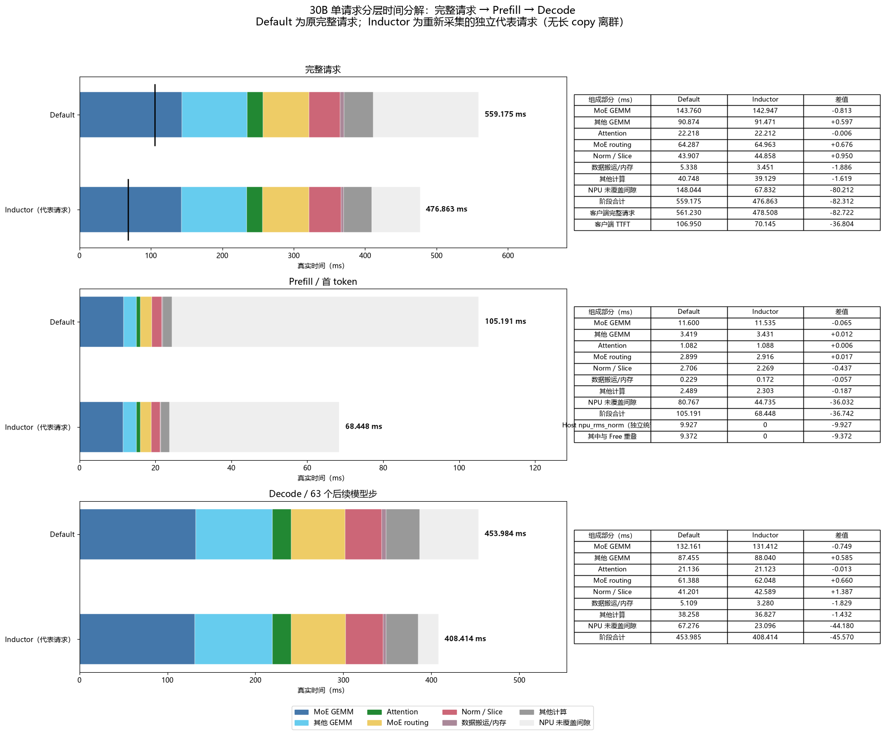
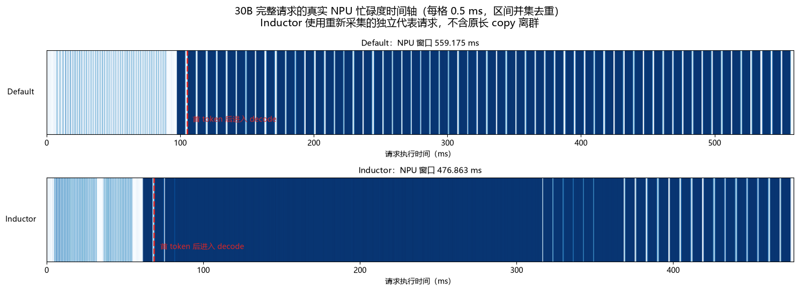
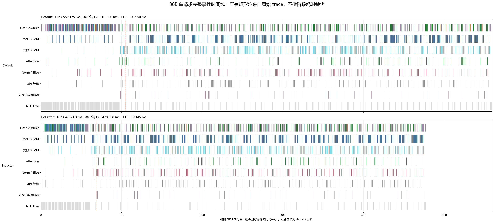
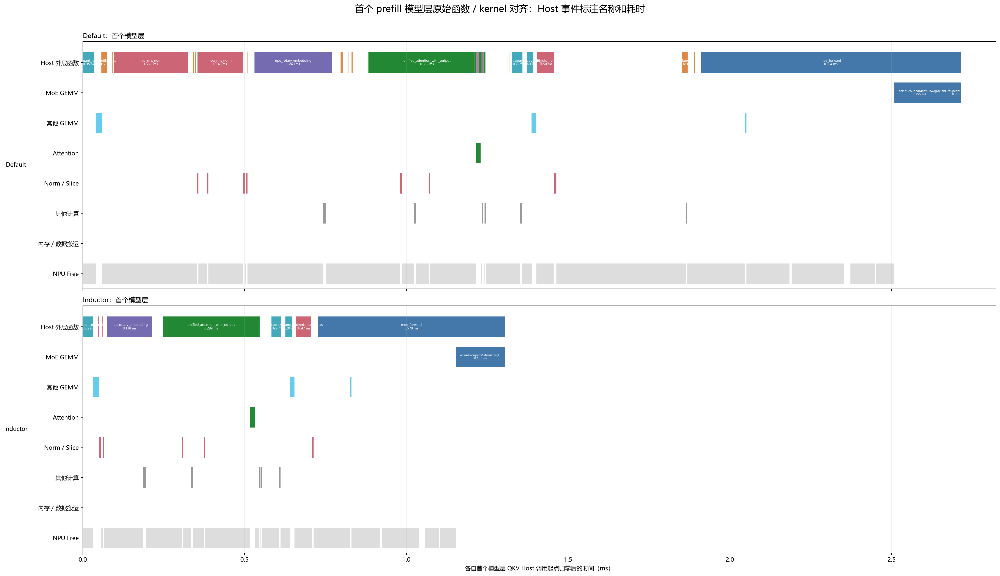
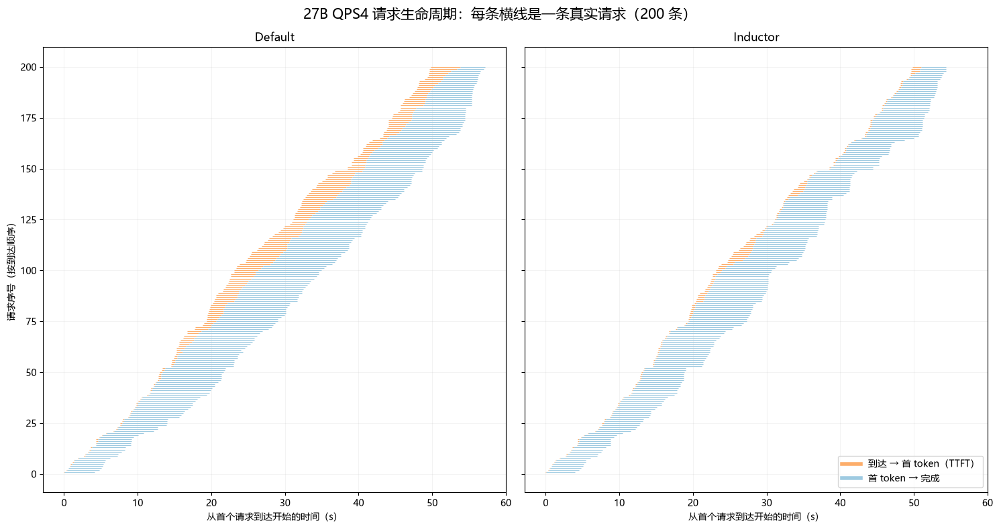
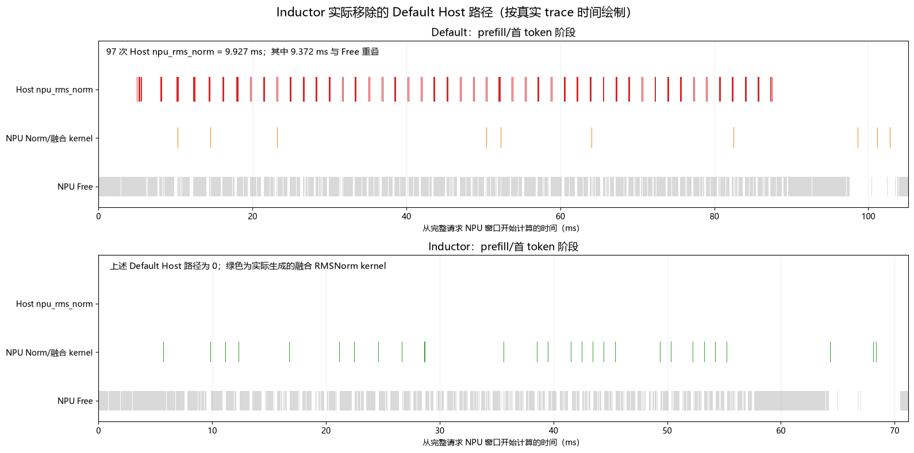
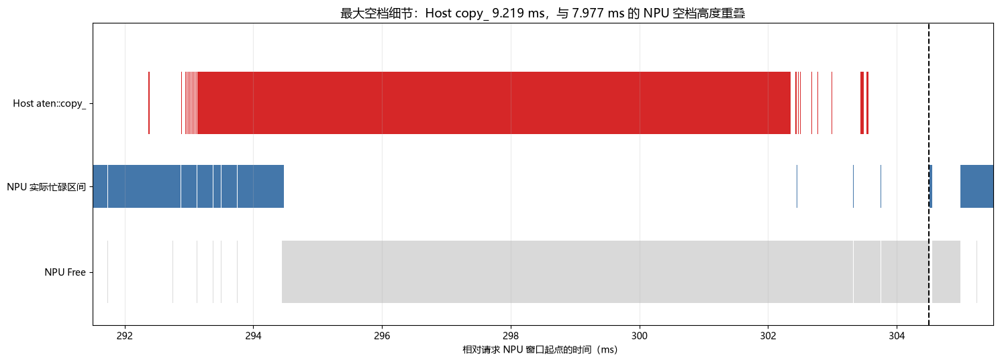

# Inductor 请求级可视化证据

日期：2026-11-23。本文只使用真实请求时间戳和 NPU kernel 事件，不用汇总百分比代替请求过程。

## 1. 单请求：完整时间分解

实验为 30B-A3B-W8A8、TP1、256 个输入 tokens、64 个输出 tokens。每条柱代表一个完整请求；黑色竖线划分 prefill/首 token 与后续 decode。Default 使用原完整请求，Inductor 使用重新采集的独立代表请求；后者最大 `aten::copy_` 为 0.067 ms，不含原样本的长 copy 离群。

- Default 的 NPU 执行窗口为 559.175 ms，Inductor 为 476.863 ms，减少 82.312 ms。
- 客户端完整请求时间为 561.230 → 478.508 ms，减少 82.722 ms；TTFT 为 106.950 → 70.145 ms，减少 36.804 ms。
- Prefill NPU 窗口为 105.191 → 68.448 ms，减少 36.742 ms；其中未覆盖间隙为 80.767 → 44.735 ms，减少 36.032 ms。
- Decode NPU 窗口为 453.984 → 408.414 ms，减少 45.570 ms；其中未覆盖间隙为 67.276 → 23.096 ms，减少 44.180 ms。
- 全程 Host/空闲间隙为 148.044 → 67.832 ms，减少 80.212 ms，是最大变化项。
- 数据搬运/内存减少 1.886 ms，其他计算减少 1.619 ms；MoE GEMM、其他 GEMM 和 Attention 基本持平。

因此，这个代表请求的最大变化仍是**请求内部的空闲/Host 间隙缩短，而不是主要计算 kernel 普遍提速**。跨 stream 的时间重叠只计算一次，柱长与原始 trace 窗口严格一致。第 4 节的 32.351 ms 六段根因定量使用原 Default/Inductor 成对样本，与本节新代表请求分开陈述，不把两次请求的数值混算。

## 2. 单请求：真实 NPU 忙碌度时间轴

每格为 0.5 ms，颜色深度表示该格内实际 NPU 忙碌时间占比。红色虚线为首 token 后的 decode 分界。该图用于观察请求执行过程中何时出现间隙，而不是把全程汇总成一个平均值。

### 2.1 双方从零开始的完整事件级时间线

- [交互式事件时间线](../../../../profilling/20261123_023654_inductor_visual_evidence/20261123_023654_30b_aligned_event_timeline.html)：离线打开后可缩放、平移、搜索，并切换完整请求、prefill、指定模型层、decode 和指定 decode 步。悬停或点击事件可查看函数/kernel 名称、相对起止时间、耗时、stream 和线程。
- [完整请求原始事件总览](20261123_023654_inductor_visual_evidence/20261123_023654_30b_aligned_event_timeline_overview.png)：Default 和 Inductor 分别以各自 NPU 起点为零，按 Host、MoE GEMM、其他 GEMM、Attention、Norm/Slice、其他计算、内存和 Free 分行。
- [首个 prefill 模型层放大](20261123_023654_inductor_visual_evidence/20261123_023654_30b_aligned_first_layer_timeline.png)：两侧分别从各自首个 QKV Host 调用开始归零，事件块直接标注名称和耗时；[对应事件表](../../../../profilling/20261123_023654_inductor_visual_evidence/20261123_023654_30b_aligned_first_layer_events.csv)逐项列出 start/end/duration。

所有矩形均来自原始事件，没有用阶段平均耗时替代。默认 Host 行只取模型线程外层调用，避免父子 API 重复遮挡；交互版可展开嵌套 Host API 和控制事件。TP1 该请求没有 HCCL 通信事件，因此不虚构通信行。客户端 E2E/TTFT 与 NPU trace 属于不同观察窗口，仅并列显示数值，不把两套时钟硬对齐；带栈 Profile 也只用于调用链证明，不拼入这条时间线。

交互版按 48 组 prefill Attention 和 63 个 decode `MODEL_EXECUTE` 锚点划分纯执行阶段，所以顶部纯 prefill split 为 Default 97.144 ms、Inductor 61.073 ms；上方分层汇总图沿用第二个 `MODEL_EXECUTE` 作为“首 token 后”的分解边界，分别为 105.191 ms、68.448 ms。前者用于逐层执行归因，后者用于和客户端 TTFT 观察窗口衔接，两套边界服务于不同问题，不交叉计算收益。

## 3. 多请求：每条请求的真实生命周期

每条横线都是一条真实请求：

- 橙色：到达到首 token；
- 蓝色：首 token 到完成。

Default 在测试中段的橙色段明显拉长，说明更多请求等待首 token；Inductor 的橙色段较短，并且更快完成。这张图展示的是 200 条请求各自的到达、首 token 和完成时间，不是平均指标重组。

## 4. 根因可视化：什么执行路径替换了什么

这张图直接按原始 trace 时间绘制。红色区段是 Default 的 97 次 `npu::npu_rms_norm` Host 外层调用，绿色区段是 Inductor 实际生成的 Triton RMSNorm kernel。完整分析还定位了第二条图中未展开的 MoE 入口路径。

| 模型层阶段 | Default 墙钟 | Inductor 墙钟 | 节省 | 其中 Free 节省 |
|---|---:|---:|---:|---:|
| QKV + Q/K RMSNorm | 14.342 ms | 3.271 ms | **11.071 ms** | 10.970 ms |
| RoPE | 7.786 ms | 5.704 ms | **2.082 ms** | 2.577 ms |
| Attention 准备 + Attention | 15.794 ms | 12.425 ms | **3.369 ms** | 3.362 ms |
| 输出投影 + 残差归一化 | 7.802 ms | 6.902 ms | **0.900 ms** | 0.784 ms |
| MoE auto-functionalization 与入口准备 | 12.332 ms | 0.672 ms | **11.660 ms** | 11.622 ms |
| MoE 自定义算子内部 | 22.725 ms | 19.457 ms | **3.269 ms** | 2.352 ms |
| **合计** | **80.781 ms** | **48.430 ms** | **32.351 ms** | **31.667 ms** |

两条主要替换关系如下：

1. **`split_with_sizes/view + CANN npu_rms_norm` → 两个 Triton RMSNorm kernel + stride/offset 寻址。** Default 的 97 次独立 RMSNorm Host 调用累计 9.927 ms，其中 9.372 ms 与 Free 重叠；Inductor 不再出现这些外层调用。数学归一化仍然执行：双方 device 任务均为 194 个，累计 device 时间仅从 0.913 ms 降为 0.894 ms。因此省的是 Host workspace、dispatch 和独立视图节点，不是省掉 RMSNorm 计算。
2. **MoE 的 `auto_functionalized_v2` 参数重建和 clone → 生成代码直接调用 `moe_forward`。** 带栈 Profile 确认 Default 每层执行 `_generate_new_op_kwargs_from_bases → maybe_copy → clone_preserve_strides`，48 个根级 clone 全部来自这里；其中仅 `view → as_strided` 之间的 Python 参数重建间隔就有 9.425 ms。Inductor 保留全部 48 次 MoE 自定义算子，但不再经过这层运行时包装，相关根级 clone 为 0。

所以，单请求收益可以明确表述为：**Inductor 用生成代码替换 Default 的图运行包装和独立算子准备路径，减少 Host 参数处理、workspace 查询、复制与提交间隔；模型主要数学计算仍保留。** 六段层内分析合计快 32.351 ms，其中 31.667 ms 是 Free 缩短，NPU 忙碌时间只减少 0.686 ms。MoE 栈证据见 `../../../../profilling/20261123_032729_inductor_root_cause_evidence/20261123_032729_30b_moe_auto_functionalization_stack.json`。

## 5. 最大空档：操作可能存在，但长停顿是偶发的

最大空档位于 294.471–302.448 ms，持续 7.977 ms；Host 侧一次 `aten::copy_` 持续 9.219 ms，两者高度重叠。它发生在 decode 第 33→34 个模型步之间。

但需要区分两件事：

- **copy 操作本身可能是正常的数据更新**：两条路径都反复出现同类操作，现有 trace 不能证明它语义上完全不需要。
- **这次 8–9 ms 的停顿不是固定成本**：相邻模型步的同序 copy 仅约 0.007–0.008 ms；连续 5 次相同 Inductor 请求中，`aten::copy_` 最大值只有约 0.075 ms，没有复现这次 9.219 ms 的长调用。

所以最大空档应解释为**一次离群的 Host 停顿**，不能当成 Inductor 的必然开销，也不能当成稳定优化点。重复性数据见 `../../../../profilling/20261123_032729_inductor_root_cause_evidence/20261123_032729_30b_gap_repeatability.csv`；模型步位置、copy 重叠和相邻 copy 的详细计算见同目录的 `20261123_032729_30b_gap_initial_analysis.md`。

## 6. 打开原始 trace

可以用 Perfetto 进一步查看每个事件的原始时间戳：

1. 打开 `https://ui.perfetto.dev`；
2. 选择 **Open trace file**；
3. 分别导入：
   - `../../../../profilling/20261123_023654_inductor_visual_evidence/20261123_023654_30b_full_request_default_trace_view.json`；
   - `../../../../profilling/20261123_023654_inductor_visual_evidence/20261123_023654_30b_full_request_inductor_trace_view.json`；
   - 新代表请求：`../../../../profilling/20261123_023654_inductor_visual_evidence/20261123_023654_30b_typical_request_inductor_trace_view.json`。
4. 按 `GroupedMatmul`、`QuantBatchMatmul`、`FusedInferAttentionScore`、`RmsNorm`、`Slice`、`triton_unk` 等关键词检查真实事件。

也可以使用 MindStudio/MindStudio Insight 导入 Ascend Profile 目录，查看 Host API、device task 和 stream 时间线。对比时应选择相同请求、相同阶段，并注意不同 stream 的重叠不能重复计时。

## 7. 文件说明

主文档引用的请求级 PNG 保留在 `20261123_023654_inductor_visual_evidence/`，根因 PNG 保留在 `20261123_032729_inductor_root_cause_evidence/`。SVG、交互 HTML、原始 trace、生成脚本、事件表和清单已按相同子目录移动到 `../../../../profilling/`；Host 事件统计和重复空档证据位于 `../../../../profilling/20261123_032729_inductor_root_cause_evidence/`。早期仅根据汇总数字绘制的抽象图已删除。
