# Inductor 三大优势场景：收益来源与代码级证据

日期：2026-11-23。环境：A5-25，Ascend950DT，torch 2.13 / vLLM 0.33。

本文从 2026-11-22 矩阵批次（`server-results/benchmark/20261122_matrix_01/`）中筛出 **Inductor 相对 Default 收益最大的三个场景**，用 Profiling、生成代码对比和请求级数据说明收益到底来自哪里。三个场景的收益机制各不相同，覆盖了 Inductor 在 NPU 上获得收益的三种典型路径。

> 阅读约定：Default 指 `AscendCompiler` 路径，Inductor 指 `backend=inductor`（底层 `triton_experimental`）；两条路径均为 O2、`FULL_AND_PIECEWISE`，模型、TP、seed、负载完全一致。是否实际执行 ACL graph replay 还取决于运行时 shape，详见 1.1 节的覆盖边界。所有收益数字来自未开 Profiler 的 `vllm bench serve`，Profile 只用于解释机制。本文只讨论性能，不讨论数值精度（三个场景的固定输入 logprob 均未通过矩阵容差）。

## 0. 一页速览

| 场景 | 最大端到端收益 | 收益类型 | 直接机制（代码级） | 证据图 |
|---|---|---|---|---|
| **Qwen3-8B-W8A8** | QPS16 三轮复测吞吐 **+9.06%～+11.09%** | 持续负载下的稳定系统收益 | Q/K RMSNorm 融合 + Slice 消除 → Host launch 与设备空闲下降 | [fig2](#fig2)、[fig5](#fig5)、[代码对比①](#code1) |
| **Qwen3.8-27B-W8A8** | QPS4 TTFT **-79%/-85%**（两轮）、TPOT **-17%/-20%** | 新 prefill/首 token 步阻塞 decode；Inductor 缩短共同停顿 | 非 replay 的 prefill/混合路径融合与 Host 准备减少；纯 decode 对照无长尾收益 | [fig3](#fig3)、[fig6](#fig6)、[fig7](#fig7)、[代码对比③](#code3) |
| **Qwen3-30B-A3B-W8A8** | QPS1 TTFT **-25%**（75.7→57.1 ms） | 单请求 prefill 直接收益 | MoE 入口 auto_functionalized_v2 移除 + RMSNorm 融合 → Host 空闲下降 | [fig1](#fig1)、[代码对比①②](#code1) |

**一句话结论：** 三个场景的收益都不来自主要 GEMM/Attention/MoE kernel 的提速（这些实测基本持平），而来自 **Inductor 图融合消除了独立算子之间的 Host 调用、参数准备和数据重排，缩短了设备空闲（Free）**；在持续请求负载下，这一单步收益进一步减少排队和长尾停顿，端到端收益被放大。

> **重要补充（5.6 节）：** 控制图捕获 size 的公平对照显示，下表的 Inductor 收益是在**两条路径都用原始 32 上限**时测得的。把两条路径都开到 1024 后，Inductor 的净收益从 +10% 收窄到 **+2%（8B）/ +3%（30B）**——扩大捕获与 Inductor 作用于同一处 Host 开销，大部分不可叠加。但 Inductor + 1024 仍是最优配置，比 Default1024 高 2～3%。

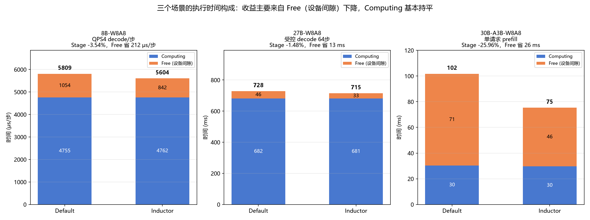

上图是三个场景代表性执行单元的时间构成：**蓝色 Computing 基本持平，橙色 Free（设备间隙）明显下降**。这是三个场景共同的时间线特征，也是本文所有代码级证据指向的统一机制。

## 1. 统一机制：Inductor 省的不是计算，是计算之间的"接缝"

三条代码级对比链贯穿三个场景。它们都能在 Inductor 生成代码（`torch_compile_cache/.../inductor_cache/*.py`）和 Default 的 CANN 调用序列之间逐一对应。

<a id="code1"></a>
### 1.1 机制一：Q/K RMSNorm —— 三个独立算子 + CANN Host 调用 → 单个 Triton kernel（8B、30B 共有）

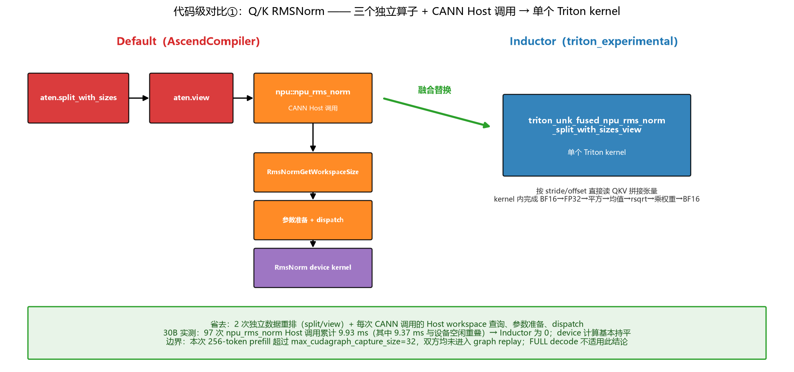

Default 对 Q、K 做 RMSNorm 时，先 `split_with_sizes` 从 QKV 拼接张量切出 Q/K，再 `view`，最后调用 CANN 的 `npu::npu_rms_norm`。每次 CANN 调用都有 Host 侧的 workspace 查询（`RmsNormGetWorkspaceSize`）、参数准备和 dispatch。

Inductor 把 `split + view + rms_norm` 融合成单个 Triton kernel（`triton_unk_fused_npu_rms_norm_split_with_sizes_view_*`），直接按 stride/offset 从 QKV 拼接张量读取，kernel 内一次完成 BF16→FP32→平方→均值→rsqrt→乘权重→BF16。

**关键定量证据（30B 单请求 prefill）：**

- Default 的 97 次 `npu::npu_rms_norm` Host 外层调用累计 **9.927 ms**，其中 **9.372 ms 与设备空闲重叠**；Inductor 为 **0**。
- 两条路径的 Q/K RMSNorm **device 任务都是 194 个**，累计 device 时间仅从 0.913 ms 降为 0.894 ms（省 0.019 ms，基本持平）。
- 也就是说：**归一化的数学计算仍然执行、device 计算基本相同；省掉的是每次独立 CANN 调用的 Host 工作和独立 split/view 节点。**

**为什么这些 Host 调用没有被图捕获消除？**

不是 Default 没开图捕获，而是 **图在初始化时已经捕获，但本次 256-token prefill 没有命中可重放的图**。完整过程如下：

1. **双方配置相同。** Default 和 Inductor 都是 `FULL_AND_PIECEWISE`：decode 使用 FULL 图，prefill/混合批次使用 PIECEWISE 图。这里要区分两个概念：`AscendCompiler`/Inductor 的**图编译与融合**仍然生效；被绕过的是其外层的 **ACL graph capture/replay**。
2. **初始化只覆盖预设尺寸。** 本次服务最终配置为 `cudagraph_capture_sizes=[1, 2, 4, 8, 16, 24, 32]`、`max_cudagraph_capture_size=32`，初始化日志中 FULL 和 PIECEWISE 各捕获 7 种尺寸。Ascend 的默认上限按 `min(max_num_seqs × decode_query_len, 512)` 推导；本次 `max_num_seqs=32`、无投机解码（`decode_query_len=1`），所以上限为 **32 tokens**。该上限不是模型输入长度上限，与 `max_model_len=40960` 无关。
3. **本次 prefill 超出覆盖范围。** 受控实验一次 prefill 有 256 个输入 token，dispatcher 在 `num_tokens > max_cudagraph_capture_size` 时直接返回 `CUDAGraphMode.NONE`（`.upstream-vllm-0.33.0/vllm/v1/cudagraph_dispatcher.py:270-279`）。因此它不会临时为 256 tokens 再捕获一张图，而是直接运行编译后的 callable，RMSNorm、split/view 和 MoE 参数准备等 Host 工作仍然每次执行。
4. **trace 与上述分派一致。** 97 次 `npu::npu_rms_norm` 位于 prefill；63 次 `aclmdlRIExecuteAsync` 只对应后续 63 个 FULL decode 步，prefill 没有 graph replay 记录。

默认这样设计，是因为图捕获面向**固定 shape 的重复执行**：prefill 长度高度可变，为任意长度建图会增加捕获时间、内存池和静态缓冲区成本，并且 PIECEWISE 仍需把不兼容的 Attention 等操作留在图外。默认尺寸主要覆盖重复性最高的小 batch 和 decode，而不是所有 prefill 长度。

所以，这里比较的是**双方在同一个非 replay prefill 上的执行路径**：不是“Default 没开图、Inductor 开了图”，而是双方都没走 replay，Inductor 生成代码本身的 Host 开销更低。相应地，RMSNorm 和 MoE 的这段 Host 根因可用于解释 prefill 收益，不能直接外推到已被 FULL 图捕获的 decode。

<a id="code2"></a>
### 1.2 机制二：MoE 入口 —— 省掉参数复制，而不是更换 MoE 算子（30B 独有）

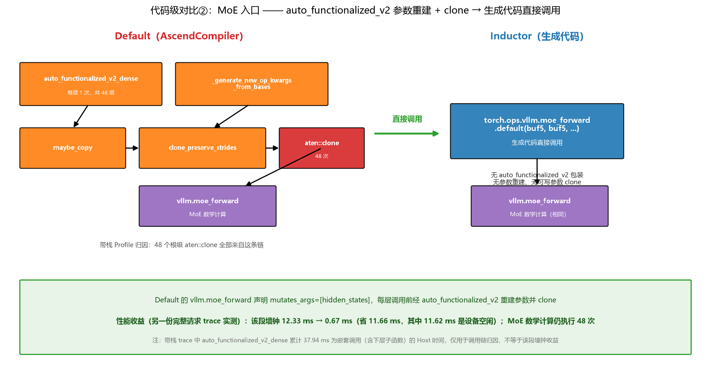

这是 30B 单请求 prefill 中收益最大的一条链。先说明一个容易误解的点：**Default 和 Inductor 使用的是同一个 `torch.ops.vllm.moe_forward.default`，也都执行了 48 次 MoE 计算。差别只在调用算子之前的准备工作。**

#### 1. 为什么 Default 要先复制一份输入

`vllm.moe_forward` 声明了 `mutates_args=["hidden_states"]`，表示它会**原地修改** `hidden_states`。编译器为了把模型转换成没有外部副作用的图，需要保守地保护原始输入。可以把这种转换简化为：

```python
# 转换后的语义：先复制，再修改副本
hidden_states_new = clone(hidden_states)
moe_forward(hidden_states_new, ...)
# 后续使用 hidden_states_new
```

如果其他 tensor 与 `hidden_states` 共享存储，或者后续还要读取修改前的值，这个复制就是必要的。

Default 的 `AscendCompiler` 走 `aot_autograd`。生成的 higher-order 节点在运行时由 `auto_functionalized_v2_dense` 执行：先重建可变参数，再复制输入，最后才调用 MoE 算子。带 Python 栈的 Profile 看到的实际调用链是：

```text
auto_functionalized_v2_dense
  → _generate_new_op_kwargs_from_bases   # 重建可变参数
  → maybe_copy                           # 判断是否需要复制
  → clone_preserve_strides               # 保留 stride 的复制
  → aten::clone
```

这条路径没有继续做“本次复制是否可以省掉”的分析，因此 48 层都保留了这套准备工作。

#### 2. Inductor 为什么能够直接调用原算子

Inductor 多做了两步编译期处理：

1. **判断是否真的需要复制。** `reinplace_inplaceable_ops` 分析被修改 tensor 的别名和后续使用关系，决定哪些输入必须 clone。只有确认后续不再依赖修改前的旧值、原地修改不会影响其他可见别名时，才允许复用原输入。
2. **展开 functionalization 包装。** `decompose_auto_functionalized` 把 higher-order 节点展开成“必要的 clone + 原 mutable 算子”。本例中待 clone 集合为空，所以生成代码只剩原算子的直接调用：

```python
# 20261123_032729_30b_inductor_output_code.py 第 325 行
buf8 = torch.ops.vllm.moe_forward.default(buf5, buf5, None, None, arg10_1, 0)
```

因此，Inductor 并不是绕过语义检查，也不是使用另一个 MoE 实现，而是**在编译期证明了此处可以安全地原地执行，从而省去防御性复制**。如果不能证明安全，clone 仍应保留。

> `enable_auto_functionalized_v2=False` 不是根因。这个 vLLM Inductor 配置主要用于兼容依赖 V1 的自定义 fusion pass；Inductor 对 V1/V2 都有相应的 reinplace 和 decompose 处理。Default 也不是原则上不能直接调用，而是当前 `aot_autograd` 路径没有执行这层 copy-elimination。

#### 3. 这条链实际省掉了什么

- **调用结构**：Default 的 48 个根级 `aten::clone` 全部属于上述 auto-functionalization 链；Inductor 中为 0。
- **计算没有改变**：双方的 `vllm.moe_forward` 都执行 48 次，MoE 数学计算没有被删除。
- **实际性能收益**：在另一份完整请求 trace 中，该段墙钟从 **12.33 ms 降为 0.67 ms**，省 11.66 ms，其中 11.62 ms 是设备空闲时间缩短。

> 证据口径：带 Python 栈的 trace 只用于确认调用链，不用其受扰动的墙钟计算性能收益。其中 `auto_functionalized_v2_dense` 累计 37.94 ms 是包含下层子函数的嵌套 Host 时间，不能逐项相加，也不等于该段墙钟收益。与机制一相同，这里的定量收益来自未进入 graph replay 的 256-token prefill，不代表 FULL decode replay 中仍存在这些 Host 调用。

<a id="code3"></a>
### 1.3 机制三：多算子融合 —— 独立量化/归一化/激活 → 少数融合 Triton kernel（27B 独有）

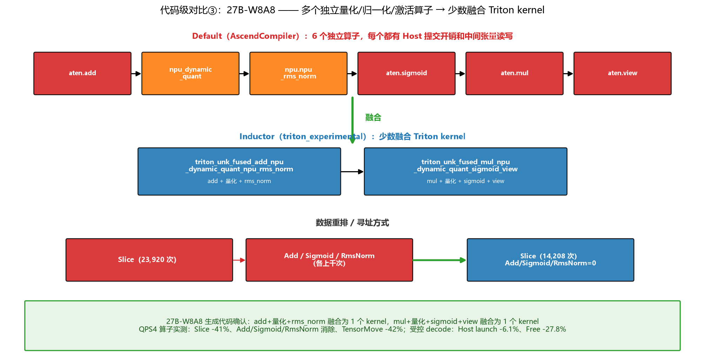

27B-W8A8 是量化模型，Default 路径上 add、动态量化、rms_norm、sigmoid、mul、view 是 6 个独立算子，每个都有 Host 提交开销和中间张量读写。

本次补采的 27B-W8A8 Inductor 生成代码（38 个文件，`profilling/20261123_top3_code_evidence/27b_w8a8_generated_code/`）确认了多算子融合：

- `triton_unk_fused_add_npu_dynamic_quant_npu_rms_norm_0`：add + 动态量化 + rms_norm 融合为 1 个 kernel；
- `triton_unk_fused_mul_npu_dynamic_quant_sigmoid_view_0`：mul + 量化 + sigmoid + view 融合为 1 个 kernel；
- `triton_unk_fused_clone_split_*`：clone + split 融合。

配合寻址方式优化（按 offset 直接读，不再先 Slice 再重排），QPS4 算子归一化实测：**Slice 23,920→14,208 次（-41%）、Add 10,787→0、Sigmoid 1,072→0、RmsNorm 67→0、TensorMove -42%**；受控 decode 实测 Host launch 时间 -6.1%、Free -27.8%（见 3.4 节）。

## 2. 场景一：Qwen3-8B-W8A8 —— 高并发下吞吐收益约 10%

### 2.1 QPS16 三轮独立服务复测

使用 `tests/benchmark/` 中已提交且与服务器 SHA256 完全相同的工具，在双方均复用 warm cache、同一空闲 NPU 0 的条件下，按 Default → Inductor 顺序做了三轮独立服务复测。每轮均为 200/200 成功，双方逐请求输入/输出长度完全一致，到达时间最大差不超过 2.02 ms。

| 轮次 | 输出吞吐：D → I（tokens/s） | 吞吐收益 | 平均 TPOT：D → I（ms） | 平均 TTFT：D → I（ms） |
|---|---|---:|---:|---:|
| 复测 1 | 2679.7 → 2976.9 | **+11.09%** | 10.49 → 9.36 | 2280.6 → 1437.4 |
| 复测 2 | 2727.6 → 2994.6 | **+9.79%** | 10.30 → 9.28 | 2143.5 → 1388.7 |
| 复测 3 | 2733.7 → 2981.4 | **+9.06%** | 10.27 → 9.33 | 2131.2 → 1430.9 |

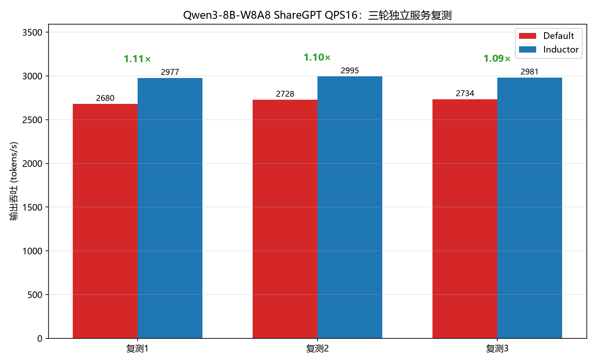

三轮吞吐收益为 **+9.06%～+11.09%，平均约 +10.0%**；TPOT 加速比为 1.10～1.12，TTFT 加速比为 1.49～1.59。三轮 Inductor 吞吐均在 2977～2995 的窄区间内，Default 为 2680～2734，双方均较稳定。长上下文负载不在本次复测范围内。

### 2.2 QPS4 一轮复测

使用与 QPS16 相同的工具、warm cache 和 NPU 0，对 QPS4 做一轮 Default → Inductor 复测：

| 指标 | Default | Inductor | 加速比（越高越好） |
|---|---:|---:|---:|
| 输出吞吐 | 989.07 tokens/s | 989.78 tokens/s | 1.001× |
| 平均 TPOT | 7.424 ms | 7.244 ms | 1.025× |
| 平均 TTFT | 48.48 ms | 43.69 ms | **1.110×** |

双方均为 200/200 成功，逐请求输入/输出长度一致，到达时间最大差 9.69 ms，最大并发请求数均为 20。QPS4 下吞吐基本持平，收益主要表现为 **TTFT 和 TPOT 的小幅下降**。

### 2.3 收益来源：融合降低 Host/Free，并适度减少积压

8B 的机制一（RMSNorm 融合 + Slice 消除）有直接执行证据：QPS4 Profile 第二个窗口按引擎步归一化，算子数/步 -9.76%、Host launch 次数/步 -8.22%、Free/步 -20.14%、Stage/步 -3.54%，而 Computing/步基本持平（+0.14%）。

三轮 QPS16 复测中，最大并发请求数分别从 **93/91/91 降到 80/77/80**，说明 Inductor 能更快完成请求并减轻积压。该场景的可复现结论是：**图融合降低 Host 和设备空闲开销，在持续负载下进一步减少排队，最终形成约 10% 的吞吐收益。**

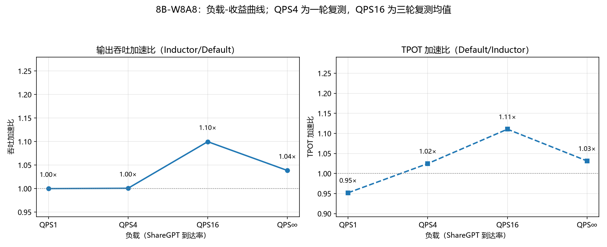

上图为 8B 模型单独的负载-收益曲线，QPS4 使用一轮复测结果，QPS16 使用三轮复测均值。

## 3. 场景二：Qwen3.8-27B-W8A8 —— TTFT 降 80%+，长尾停顿缩短

### 3.1 端到端收益（两轮均复现，重复性最好）

| 轮次 | 输出吞吐（D→I） | 平均 TPOT（D→I） | 平均 TTFT（D→I） |
|---|---|---|---|
| QPS4 第1轮 | 892.2 → 937.7（+5.1%） | 29.02 → 24.14 ms（-16.8%） | 1887.0 → 388.5 ms（**-79.4%**） |
| QPS4 第2轮 | 876.9 → 937.8（+6.9%） | 29.66 → 23.61 ms（-20.4%） | 2144.9 → 312.4 ms（**-85.4%**） |

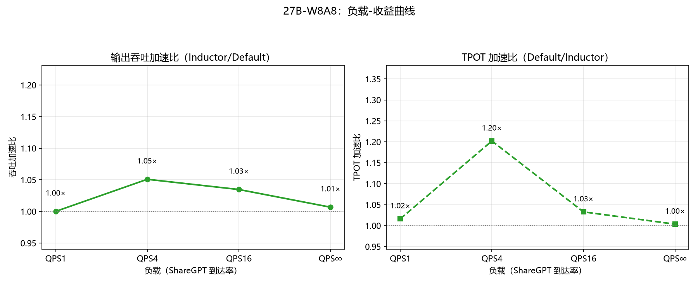

### 3.2 TTFT：缩短的是首 token 前的等待，不是单纯加快 prefill 计算

**TTFT（Time To First Token）是从请求发出到收到第一个 token 的时间。** 在持续负载下，可以把它理解为：

```text
TTFT = 等待引擎开始处理该请求的时间 + prefill 与首 token 的实际执行时间
```

其中 prefill kernel 计算只影响第二部分。如果前面还有很多请求没处理完，新请求即使本身计算很快，也要先排队。

按请求顺序每 50 个划分一段，平均 TTFT（ms）如下：

| 路径 | 1~50 | 51~100 | 101~150 | 151~200 |
|---|---:|---:|---:|---:|
| 第1轮 Default | 146 | 1745 | 3407 | 2250 |
| 第1轮 Inductor | 120 | 358 | 823 | 253 |
| 第2轮 Default | 141 | 1767 | 3703 | 2969 |
| 第2轮 Inductor | 123 | 281 | 598 | 248 |

这张表反映的是积压的形成和消退：Default 在中段出现秒级首 token 等待，Inductor 的峰值更低、回落更早。Inductor 的单步执行收益让前面的请求更早结束，后面的请求因此不必等那么久。

另一个对照是没有持续积压的 QPS1：同模型 TTFT 加速比只有 **1.12～1.15**。这更接近 prefill 路径本身的直接改善量级。因此，QPS4 的 **4.86～6.87 倍 TTFT 加速**不能解释成 prefill kernel 计算提速了数倍；它主要来自**首 token 前的排队等待缩短**。

### 3.3 TPOT：少量超长 token 间隔拉高了平均值

**ITL（Inter-Token Latency）是相邻两个输出 token 之间的时间间隔；平均 TPOT 可以看作这些间隔的平均值。** 所谓“长尾间隔”，就是少数明显超过正常水平的间隔。本报告用 **50 ms** 作为分析分界，它不是某个内核的阈值，只是用来把普通间隔和超长停顿分开统计。

例如，假设有 100 个间隔：90 个为 10 ms，10 个为 100 ms，则平均值是 19 ms，中位数仍是 10 ms。如果把那 10 个长间隔缩短到 50 ms，平均值降为 14 ms，中位数依然不变。这说明**少量长停顿可以显著拉高平均值，而普通 token 的速度未必明显变化。**

27B 的实际数据正是这种情况：第 1 轮 median ITL 仅从 **16.50 → 16.29 ms**，但平均 TPOT 从 **29.02 → 24.14 ms**。所以这里说的“长尾收益”是**超长停顿的次数和持续时间减少**，不是所有 token 间隔都同比例缩短。

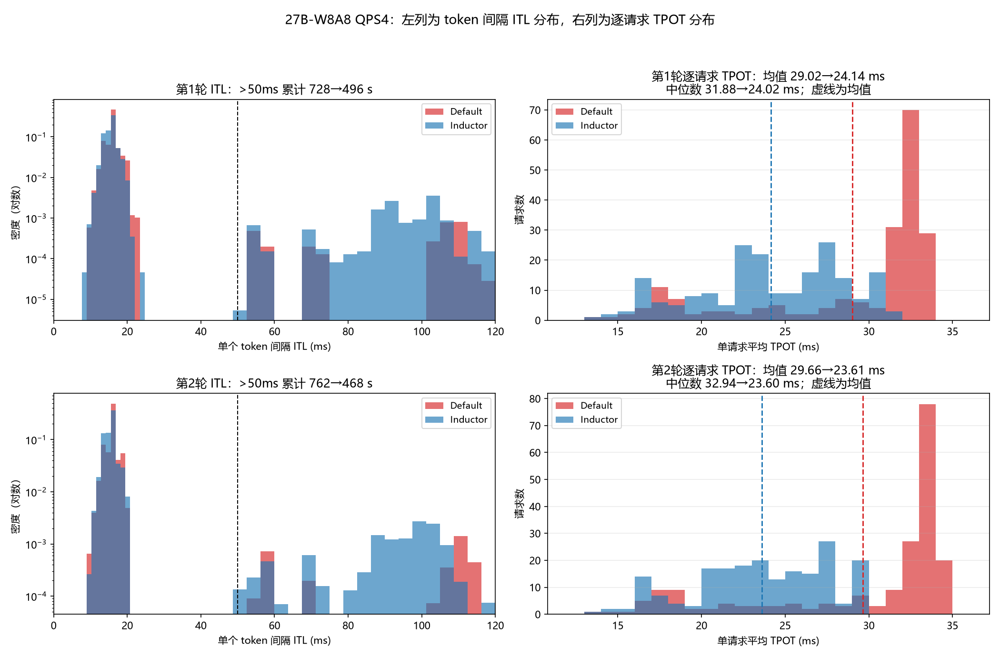

第一张图同时展示两种粒度，避免把它们混为一谈：

- **左列是 ITL 分布**：横轴为单个 token 间隔，纵轴为对数密度；50 ms 虚线右侧是本文定义的长尾区域。Inductor 将 >50 ms 间隔的累计耗时从 **728 s/762 s** 降为 **496 s/468 s**。
- **右列是逐请求 TPOT 分布**：每个样本是一条请求，而不是一个 token 间隔。逐请求 TPOT 按 `(端到端时延 - TTFT) / (输出 token 数 - 1)` 重算，均值与官方 `mean_tpot_ms` 完全一致；虚线标出均值。它展示请求级 TPOT 整体如何变化，但请求内部的长尾仍需从左列 ITL 观察。

平均 TPOT 的收益分解是另一件事，因此单独绘图：

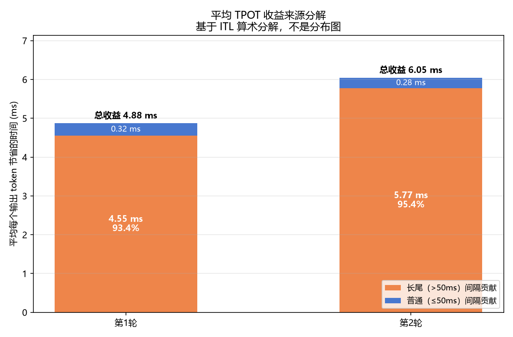

这张图回答“平均每输出一个 token 所省下的时间，分别由哪类间隔贡献”，不是分布图。计算方式是：

```text
长尾贡献 =（Default 所有 >50 ms 间隔的总时长
           - Inductor 所有 >50 ms 间隔的总时长）/ 51,000
普通间隔贡献 = 两类 ≤50 ms 间隔总时长的差 / 51,000
```

| 轮次 | 平均 TPOT 总收益 | >50ms 长尾贡献 | ≤50ms 普通间隔贡献 |
|---|---:|---:|---:|
| 1 | 4.876 ms | **4.551 ms（93.4%）** | 0.324 ms（6.6%） |
| 2 | 6.048 ms | **5.772 ms（95.4%）** | 0.276 ms（4.6%） |

第 1 轮的读法是：平均每个 token 少花 **4.876 ms**，其中 **4.551 ms** 来自超长间隔缩短，只有 **0.324 ms** 来自普通间隔。**93.4% 是平均 TPOT 收益的来源占比，不是 93.4% 的 token 得到了优化，也不是长尾在总执行时间中的占比。**

**为什么超长间隔会减少？** 需要先区分“长间隔发生在哪个阶段”和“什么事件触发了它”。下一节用逐 token 时间戳给出定位：长间隔发生在 decode 输出过程中，但触发事件是**其他新请求的 prefill/首 token 步**。

### 3.4 事件级定位：新请求的 prefill/首 token 步阻塞了正在 decode 的请求

原始 `vllm bench serve` 数据包含每条请求的到达时间、TTFT 和逐 ITL，因此可以精确重建所有输出 token 的绝对时间：首 token 时间为 `start_time + TTFT`，后续依次累加 ITL；重建后的末 token 时间与 `start_time + 端到端时延`完全相等。由此得到四层证据：

1. **长间隔是跨请求共同停顿。** 第 1 轮 Default 的 4494 个 >50 ms 间隔可合并为 155 个重叠停顿簇，99.87% 的长间隔至少有 4 条请求共同经历；Inductor 同样为 99.85%。这不是某条请求自己的 kernel 变慢。
2. **停顿结束正好对应另一条请求的首 token。** 两轮双方所有停顿簇的结束时间，与最近的新请求首 token 时间差均不超过 **0.25 ms**。下图是一个实际例子：阴影中多条请求都停止输出，阴影结束处出现 req 190 的首 token。
3. **去掉新请求插入后，长尾消失。** 固定 8 请求、256 输入/256 输出 tokens，在进入 decode 后不再到达新请求：Default 仅 **1/2040** 个间隔超过 50 ms，Inductor 为 **3/2040**；平均 ITL 分别为 **12.98/13.17 ms**，没有 Inductor 的纯 decode 优势。
4. **Inductor 缩短的是 prefill/首 token 路径。** 固定 8×256 输入的受控 prefill 中，平均 TTFT 从 **281.9 → 269.9 ms（-4.3%）**，每 rank 的 Host launch 次数从 **5180 → 4306（-16.9%）**。这与生成代码中的融合和 Host 准备减少一致，但停顿总时长还包含调度与等待，不能全部等价成某个 kernel 的提速。

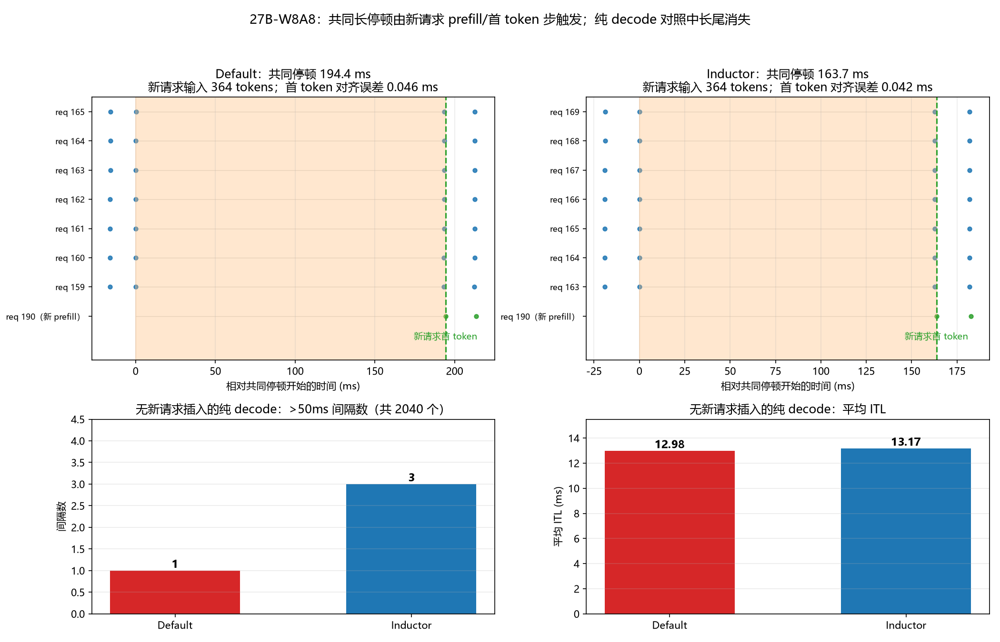

共同停顿簇的平均时长在两轮中分别从 **170.0 → 134.6 ms**、**177.0 → 126.9 ms**。因此，27B QPS4 平均 TPOT 收益的具体原因是：**持续到达的新请求在 prefill/首 token 步阻塞了现有 decode 请求，形成跨请求长间隔；Inductor 缩短了这条 prefill/调度路径，从而压短这些共同停顿。** 收益发生在 decode 的 ITL 上，但根因不在纯 decode kernel，也不在 FULL replay 图内部的 Host 接缝。

这也与图回放边界吻合：本批 ShareGPT 有 **67%（134/200）** 的请求仅输入就已经超过 32 tokens，混合批次还要叠加正在 decode 的 token；这些 prefill/混合步会因 `num_tokens > max_cudagraph_capture_size=32` 回退到 `CUDAGraphMode.NONE`。相反，纯 decode 小批量能够 FULL replay。因此，Inductor 的优势主要出现在**未进入 replay 的 prefill/混合执行路径**，而不是 replay 中的 decode 图内部。

下图明确展示了这个**按引擎步发生的执行路径切换**：纯 decode 时双方都在 FULL replay；新请求到来形成大尺寸 prefill/混合批次时切换到 NONE，并造成现有请求共同停顿；prefill 完成后再回到 FULL replay。Inductor 的收益就发生在 NONE 这一段。

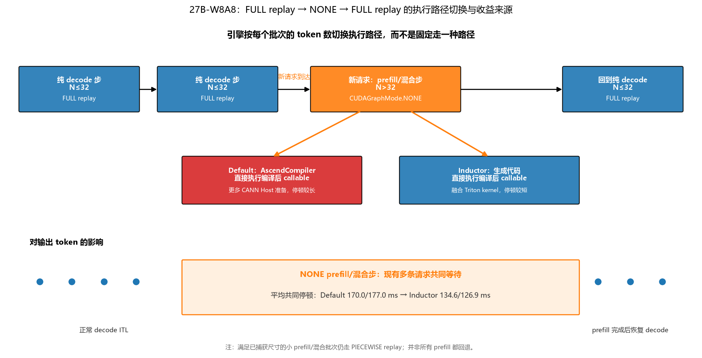

### 3.5 受控 decode：Computing 持平、Free 下降，但不能归因于图内 Host 接缝

机制三（1.3 节）的图层变化落到时间线上，最干净的对照来自**受控 decode 实验**（固定 256 输入 token、8 并发、双方相同 64 个引擎步）：

| 指标 | Default | Inductor | 变化 |
|---|---:|---:|---:|
| Stage | 839.999 ms | 827.540 ms | **-1.48%** |
| Computing | 681.981 ms | 681.362 ms | -0.09%（持平） |
| `QuantBatchMatmulV3` | 322.089 ms | 321.647 ms | -0.14%（持平） |
| HCCL | 338.328 ms | 337.999 ms | -0.10%（持平） |
| Host launch 时间 | 109.735 ms | 103.036 ms | **-6.10%** |
| Free | 46.311 ms | 33.428 ms | **-27.82%** |

Computing、量化 GEMM、HCCL 都基本持平，下降的是 Host launch 累计时间和 Free。但**不能因为 prefill 中存在 Host 接缝收益，就把这段已回放的 decode 也归因于图内 Host 调用消除。** 对双方各 64 个 replay 步、两个 rank 的 Host API 汇总后，主要调用的次数并未减少：

| Host API（两 rank 合计） | Default 次数 | Inductor 次数 |
|---|---:|---:|
| `aclmdlRIExecuteAsync` | 128 | 128 |
| 汇总节点 `launch` | 7168 | 7168 |
| `aclnnInnerFusedInferAttentionScoreGetWorkspaceSize` | 2048 | 2048 |
| `aclrtLaunchKernelWithHostArgs` | 6400 | 6400 |

因此，Host launch 时间 -6.10% 是**相同调用次数下的累计耗时差异**，不能写成“Inductor 减少了这些 Host 调用”。Free 的小幅下降是实际测量现象，但现有证据不足以把它定位到某一项图内 Host 优化；图外引擎工作、调度衔接或测量窗口差异都可能参与，需进一步事件级对齐才能区分。

要把这个小幅单步现象与 3.3 节平均 TPOT 的大幅收益（-17%~-20%）区分开：后者主要来自超长间隔缩短这一系统结果，前者尚未形成同级别的代码级根因证明。两个层次不能互相代替。

> 说明：27B-W8A8 的 QPS4 ShareGPT Profile 窗口（TP2）两张卡的 Free 一升一降、负载不均，不适合按步归一化直接对比；因此本节用双方步数完全相同的受控 decode 实验作为单步机制证据，QPS4 的端到端收益以 3.1~3.3 节的非 Profile 原始数据为准。

### 3.6 对照实验：把 Default 的 prefill/混合图捕获上限从 32 扩到 1024

为验证“Default 只要扩大 prefill 图捕获，就能抵消 Inductor 收益”的假设，使用相同 ShareGPT QPS4、200 条请求、TP2、NPU 0/1，运行三组独立服务：

- Default32：原始 `max_cudagraph_capture_size=32`；
- Default1024：显式设置 `max_cudagraph_capture_size=1024`，捕获尺寸为 `[1,2,4,8,16,24,32,64,128,256,512,1024]`。两个 TP rank 的启动日志均从 **7 个捕获尺寸全部完成（7/7）** 变为 **12 个捕获尺寸全部完成（12/12）**；这里的分子/分母是进度条的已完成/总任务数，不是运行时 replay 命中率；
- Inductor32：Inductor 保持原始 32 上限。

| 路径 | 输出吞吐（tokens/s） | 平均 TPOT（ms） | 平均 TTFT（ms） | 共同停顿簇平均时长（ms） |
|---|---:|---:|---:|---:|
| Default32 | 945.6 | 24.05 | 420.7 | 124.5 |
| Default1024 | 899.5 | 29.64 | 2028.8 | 174.4 |
| Inductor32 | 950.4 | 22.39 | 231.9 | 108.6 |

**实际 replay 覆盖也得到了窗口级验证。** 对两条 Default 路径各自 30～32 秒的 Profile 窗口，双方都包含 9 条新请求的首 token：

| 窗口证据 | Default32 | Default1024 |
|---|---:|---:|
| 新请求首 token 数 | 9 | 9 |
| 无 replay 的 prefill Host 调用组 | **7 组** | **0 组** |
| `MODEL_EXECUTE` / `aclmdlRIExecuteAsync` | 60 / 60 | 146 / 146 |

Default32 的 7 个 prefill 步在该窗口中均未 replay；Default1024 的窗口包含新 prefill 首 token，且所有模型执行任务都有 replay。因此，**扩大长度确实让 prefill/混合工作进入了回放**。这里只证明该 2 秒窗口，不把它冒充整个 200 请求 run 的全程命中率。之前不足的是 **prefill/混合部分的 replay 覆盖**，纯 decode 的 FULL replay 一直存在。

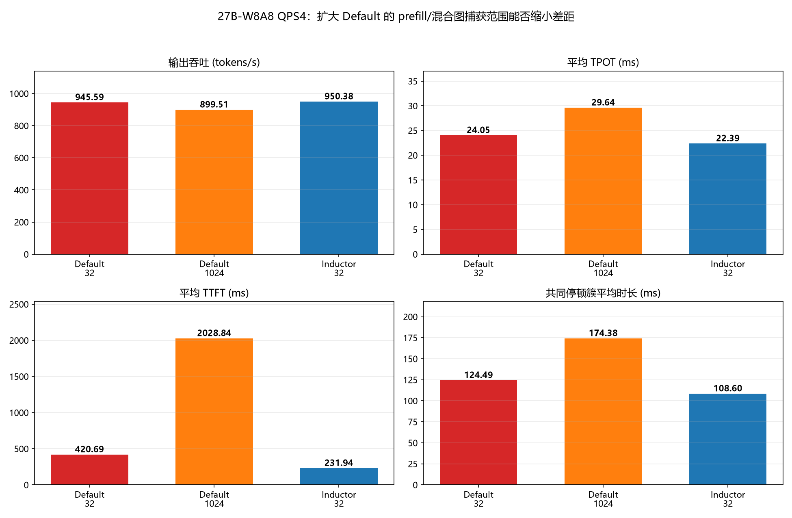

**结果没有抵消收益，反而使 Default 回退。** 这里需要更正一个早期的错误归因：曾认为回退来自图形状 padding 带来的额外计算。后续纯 prefill Profile（3.7 节）直接否定了这一点——Default1024 的 Computing 与 Default32 完全相同（279.7 vs 279.1 ms），每个算子的耗时也一致，说明 padding 并没有转化为设备端计算。纯 prefill 上扩大捕获实际让 TTFT 降低了 28%。

因此 QPS4 下的回退不是 prefill 本身变慢，而是出现在**持续到达的混合批次**中：停顿统计显示 Default1024 的停顿簇中位时长反而更长（111 → 150 ms）。混合批次的总 token 数会叠加正在 decode 的请求，落到的捕获档位与纯 prefill 不同。这一步的具体机制**尚未用 Profile 直接验证**，是当前明确的未决问题。

因此，当前证据不支持”简单扩大图捕获上限即可消除 Inductor 收益”：8B/30B 上它可以，27B 上受混合批次影响而部分抵消。更细的捕获尺寸可能改变混合批次的行为，但未验证。本次是独立新批次，绝对数值与原始批次不同，结论只用于判断扩大捕获的方向。

### 3.7 纯 prefill 三路径 Profile：收益来自 Host 开销，不是计算

为分清 prefill 本身与混合批次，对三条路径各做一次**只覆盖 prefill 的 Profile**：固定 8 个请求 × 256 输入 tokens、TP2，收到首 token 即停止采集。这样三条路径的输入形状完全一致，可以直接比较设备端和 Host 端的耗时。Inductor 组启动后校验了实际 backend 为 `inductor`。

| 两 rank 合计 | Default32 | Default1024 | Inductor32 | Inductor1024（r1 / r2） |
|---|---:|---:|---:|---:|
| **TTFT 均值** | 296.6 ms | **212.2（-28%）** | 265.1（-11%） | 247.0 / **212.3** |
| Stage | 688.7 | 500.3 | 608.2 | 588.8 / **501.1** |
| Computing | 279.1 | 279.7 | 282.7 | 283.5 / 283.2 |
| Communication | 247.3 | 142.7 | 195.0 | 170.0 / **144.3** |
| Free | 162.3 | 77.9 | 130.5 | 135.3 / **73.6** |
| `aclmdlRIExecuteAsync` 次数 | 3 | **68** | 3 | **68** |
| Host `launch` 累计 | 303.7 | 214.5 | 277.3 | 277.7 / **215.4** |

**结论一：padding 没有转化为设备端计算。** 三路径的 Computing 相同（279.1 / 279.7 / 282.7），逐算子耗时也一致：`QuantBatchMatmulV3` 164.3 / 164.6 / 164.2，HCCL 61.7 / 60.0 / 62.2。若 padding 真的被计算，Default1024 的 Computing 必然更高。

**结论二：扩大捕获在纯 prefill 上非常有效。** Default1024 让 68 个片段进入 replay（Default32 只有 3 个），Free 降 52%，Communication 降 42%，TTFT 降 28%。它的收益全部来自 Host 侧 `launch`（303.7 → 214.5 ms）和设备空闲。

**结论三：Inductor 的收益不来自”融合让计算变快”，而来自 Host 开销。** Inductor32 的 Computing 与 Default32 相同，replay 次数也相同（都是 3）。它唯一减少的算子是 `Slice`（7.8 → 3.8 ms，-51%），其余算子完全一致；收益体现为 `launch` 累计减少 9%（303.7 → 277.3）、Free 减少 20%（162.3 → 130.5）。

这修正了 1.3 节的一个表述：27B 的多算子融合在**设备端没有减少计算时间**，它的价值在于用更少的 kernel 完成同样的工作，从而减少 Host 提交和设备间隙。

**在 27B 的纯 prefill 上，扩大 Default 捕获（-28%）比 Inductor32（-11%）更有效；但把 Inductor 也开到 1024 后，TTFT 与 Default1024 持平**（I1024 第 2 遍 212.3 vs D1024 212.2 ms），两者的 Free 和 launch 也几乎相同（73.6 vs 77.9 ms；215 vs 215 ms）。这说明两种优化作用于同一处 Host 开销，在 27B 纯 prefill 上**不可叠加**。

注意 I1024 两遍差异明显（TTFT 247 vs 212 ms，Stage 589 vs 501 ms），单次测量有波动；D32/D1024/I32 目前各只有 1 遍，"持平"以 I1024 第 2 遍为准，严格确认需补 D1024 第 2 遍。

这与矩阵实验中 27B 整体收益有限的结论并不矛盾：矩阵测的是持续到达的混合负载，而本节只测 prefill。两者的差异说明 27B 扩大捕获的瓶颈在混合批次，不在 prefill 本身——这一点需要单独 Profile 混合场景才能确认。

## 4. 场景三：Qwen3-30B-A3B-W8A8 —— 单请求 TTFT -25%，根因最完整

### 4.1 端到端收益

| 负载 | 平均 TPOT（D→I） | 平均 TTFT（D→I） | 输出吞吐（D→I） |
|---|---|---|---|
| **QPS1** | 9.09 → 8.52 ms（**-6.4%**） | 75.7 → 57.1 ms（**-24.6%**） | +0.09%（受固定到达率限制） |
| QPS4 | 16.94 → 14.87 ms（-12.2%） | 102.7 → 73.9 ms（-28.0%） | +0.4% |
| QPS16 | 19.82 → 17.74 ms（-10.5%） | 8939.1 → 7312.4 ms（-18.2%） | **+11.6%** |

QPS1 双方到达并发均不超过 1，没有排队成分，TTFT -24.6% 是**纯直接执行收益**。

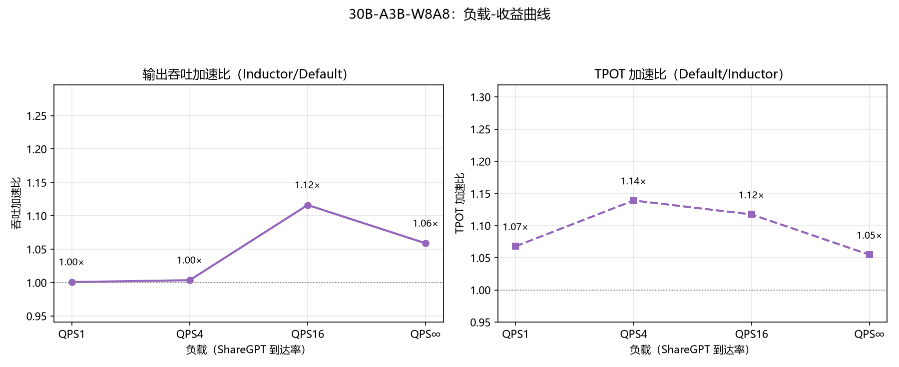

### 4.2 单请求 prefill 六段分解：收益几乎全部体现为 Free 减少

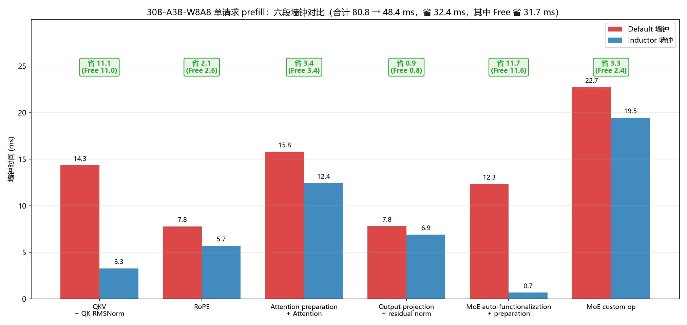

对同一 30B 单请求（256 输入 token）的完整 trace，把 48 个模型层按 Host 锚点对齐成六段。六段合计墙钟 80.8 → 48.4 ms（省 32.4 ms），其中 **Free 节省 31.7 ms、NPU 忙碌时间只省 0.69 ms**。收益最大的两段正是 1.1 和 1.2 节的两条代码链：

| 模型层阶段 | Default 墙钟 | Inductor 墙钟 | 墙钟节省 | 其中 Free 节省 |
|---|---:|---:|---:|---:|
| QKV + Q/K RMSNorm（机制一） | 14.34 ms | 3.27 ms | **11.07 ms** | 10.97 ms |
| MoE auto-functionalization 与入口准备（机制二） | 12.33 ms | 0.67 ms | **11.66 ms** | 11.62 ms |
| Attention 准备 + Attention | 15.79 ms | 12.43 ms | 3.37 ms | 3.36 ms |
| MoE 自定义算子内部 | 22.73 ms | 19.46 ms | 3.27 ms | 2.35 ms |
| RoPE | 7.79 ms | 5.70 ms | 2.08 ms | 2.58 ms |
| 输出投影 + 残差归一化 | 7.80 ms | 6.90 ms | 0.90 ms | 0.78 ms |
| **六段合计** | **80.78 ms** | **48.43 ms** | **32.35 ms** | **31.67 ms** |

### 4.3 完整因果链（30B 受控单请求 prefill）

下面是对同一受控单请求（256 输入 token、固定 token ID、与 4.2 节同一 trace）的闭环验证。注意这里的 TTFT 数字来自该受控实验（输入比 ShareGPT 长、单请求），与 4.1 节 ShareGPT QPS1 的 18.6 ms 收益是不同实验、同量级、同机制。

```text
RMSNorm 改用 Triton 实现并折叠 split/view（机制一）
+ MoE 入口移除 auto_functionalized_v2 参数重建和 clone（机制二）
+ 其他 ATen view/alias/empty 与 Python 调度减少
→ Host 在关键路径上的工作减少
→ prefill Free 减少 33.4 ms
→ TTFT 减少 33.6 ms（受控实验：106.95 → 73.36 ms）
→ 完整请求净减少 32.8 ms
```

验证闭环：Stage 减少 26.4 ms，解释受控实验 TTFT 减少量（27.8 ms，见下）的 95%；Free 减少占 Stage 减少量的 97.6%。主要 MoE/GEMM/Attention 算子累计时间基本持平（GroupedMatmulSwigluQuantV2 仅 -0.83%，Attention 仅 -0.36%）。

> 两组 TTFT 数字的关系：受控实验的 prefill Stage 缩短 26.4 ms、Free 缩短 33.4 ms，对应其 TTFT 从 97.45 ms 降至 70.37 ms（-27.8%，见证据 CSV `20261123_014925_30b_fixed1_256_prefill_summary.csv`）；完整 trace 口径（含首 token 后少量 decode）TTFT 为 106.95→73.36 ms（-33.6 ms）。ShareGPT QPS1 的真实负载 TTFT 为 75.74→57.11 ms（-18.6 ms，-24.6%）。三者同量级、方向一致，共同支持"prefill Host/Free 缩短是 TTFT 收益主因"。

## 5. 共同结论与适用边界

### 5.1 三个场景共同支持的结论

1. **Inductor 可以通过图融合和减少 Host 接缝获得收益，但这一解释有明确的回放边界**：非 replay prefill 中的 CANN 调用、auto_functionalized_v2 参数重建和 split/view 数据重排有直接证据；在已 FULL replay 的 decode 中，图内 Host 调用不会每次重新执行，不能套用同一解释。主要计算 kernel 在两类实验中都没有普遍提速证据。
2. **Inductor 的高并发收益主要来自“减轻 prefill 对 decode 的干扰”，而不是 decode 单步加速**：三模型的 median ITL 在 Default32/Default1024/Inductor32 三条路径上几乎相同，TPOT 差异全部来自 TPOT − median ITL 这一项（5.6 节）。
3. **Inductor 的净收益与图捕获窗口强相关**：捕获相同时 Inductor 领先 +10%（8B）/ +10～15%（30B）；两条路径都开到 1024 后，Inductor 仍领先 **+2～3%**，但大部分收益被扩大捕获覆盖——两者作用于同一处 Host 空闲，不可叠加。评估 Inductor 价值时应在相同捕获配置下对比（5.6 节）。
4. **直接执行收益在时间线上体现为 Free（设备间隙）和 Host launch 下降**，Computing 持平或小幅变化。
5. **持续负载会放大收益**：单步收益可通过减少排队和长尾停顿转化为更大的端到端收益（27B QPS4 TTFT 4.86~6.87×）；8B QPS16 三轮复测的吞吐收益稳定为约 1.10×。
6. **没有证据表明主要 GEMM、Attention、MoE 或 HCCL kernel 被普遍大幅提速。**

### 5.2 三种机制与场景的对应关系

| 机制 | 出现的场景 | 收益环节 |
|---|---|---|
| RMSNorm 融合 + split/view 折叠 | 8B、30B（27B 也有量化+rmsnorm 融合变体） | prefill + decode 的 Host/Free |
| MoE auto_functionalized_v2 移除 | 30B（MoE 模型） | prefill 的 Host/Free |
| 多算子融合（量化/激活/归一化） | 27B（量化模型） | 非 replay 的 prefill/混合路径 Host launch 与共同停顿 |
| 持续负载下的排队/长尾改善（系统效应） | 27B（最显著）、8B、30B | 吞吐、TTFT、平均 TPOT |

### 5.3 适用边界（不能外推）

- **长上下文回退**：27B、32768/1024、8 并发、TP2 的 Profile 显示，新增 10 类 Triton kernel 累计 159.2 ms 超过六类小算子节省的 120.4 ms，全部算子累计时间反而 +0.74%、Stage +1.11%。结论限定于已验证的中短上下文。
- **低负载不一定受益**：8B QPS1 TPOT 还略回退（加速比 0.95）；0.8B 模型 QPS1/QPS4 TPOT 也回退。高收益需要"单步收益 + 高并发积压"两个条件。
- **精度另行评估**：三个场景固定输入 logprob 均未通过矩阵容差，本文只证明性能与执行机制。

### 5.4 为什么吞吐加速比随 QPS 先升后降

收益由两部分组成：**执行本身的直接改善**，以及**持续负载下减少排队、等待和设备空隙的系统收益**。不同 QPS 下，第二部分的大小不同：

1. **低 QPS（如 QPS1）**：请求之间没有明显积压，系统收益很小；吞吐还受固定到达率限制，因此加速比接近 1。
2. **中等/较高有限 QPS（如 QPS4、QPS16）**：Default 的 Host 工作、设备空隙和执行衔接更容易形成积压。Inductor 缩短单步执行后，请求更快完成、队列更快消退，减少 TTFT 等待和超长 token 停顿，因此端到端收益被放大。
3. **QPS∞**：所有请求立即到达，双方都处于持续饱和状态。此时 Host 工作更容易与其他请求的设备计算重叠，Default 中可被消除的空隙不再充分暴露；吞吐更接近双方执行路径的持续计算上限。由于主要 GEMM、Attention、MoE 和 HCCL 没有普遍提速，Inductor 只剩较小的直接执行收益，加速比因而回落。

本次数据支持这一趋势：8B 的 QPS16 三轮复测吞吐加速比均值为 **1.10×**，QPS∞ 为 **1.04×**；27B 从 QPS16 的 **1.03×** 回落到 QPS∞ 的 **1.01×**；30B 从 QPS16 的 **1.12×** 回落到 QPS∞ 的 **1.06×**。因此，中等/较高有限 QPS 的高收益包含明显的排队与执行衔接改善，QPS∞ 更接近持续饱和下的直接吞吐能力，二者不能互相替代。

### 5.5 收益来自 prefill 还是 decode，decode 是否进行了图回放

| 场景与指标 | 主要收益阶段 | 说明 |
|---|---|---|
| 27B QPS4 的 TTFT | **prefill 前的排队 + prefill 路径** | 中段请求的秒级等待缩短，是 TTFT 大幅下降的主因 |
| 27B QPS4 的 TPOT 与吞吐 | **新 prefill/首 token 步对 decode 的阻塞** | 长间隔发生在 decode 输出中，但由其他请求的 prefill 触发；纯 decode 对照没有长尾收益 |
| 30B QPS1 的 TTFT | **prefill** | RMSNorm 与 MoE 入口的 Host 工作减少，且该 256-token prefill 未进入 replay |
| 30B 的 TPOT / 高负载吞吐 | **新 prefill/首 token 步对 decode 的干扰** | 见 5.6 节：三条路径的 median ITL 几乎相同，差异全在 prefill 干扰项 |
| 8B QPS16 的 TPOT 与吞吐 | **新 prefill/首 token 步对 decode 的干扰** | 见 5.6 节：decode 单步不变，Inductor 只减少了干扰项 |
| 8B QPS4 的 TTFT | **prefill/首 token 路径** | 一轮复测 TTFT 加速比 1.11×，吞吐基本持平 |

**decode 阶段确实进行了 FULL 图录制与回放，且 Default 和 Inductor 都启用了。** 27B 受控 decode 实验中，8 个请求每步各产生 1 个 token，`num_tokens=8`，低于 `max_cudagraph_capture_size=32`；在双方各 64 个引擎步的分析窗口内，两个 rank 均分别记录了 **64 次 `aclmdlRIExecuteAsync`**。30B 完整请求的 63 个后续 decode 步也对应 63 次图执行。

但 FULL 图只覆盖模型 forward 中被捕获的设备工作，并不覆盖整个 vLLM 引擎步；请求调度、输入输出准备、sampling、detokenization、下一步提交等 Host 工作仍可能发生。不过，27B 受控 decode 的 Host API 计数并未减少，因此不能把这段收益直接归因于“图内 Host 接缝被删除”。Computing、量化 GEMM 和 HCCL 持平，也说明收益不是 Default 没有回放或 Inductor 把大 kernel 单独提速。

### 5.6 控制捕获 size 的公平对照：Inductor 的真实净收益

要回答"Inductor 本身的优化效果有多大"，必须让两条路径的图捕获窗口相同。早期矩阵只给 Default 开了 1024 而 Inductor 保持 32，得出的"Default 反超 Inductor"是**不公平对照**，本节予以更正。

公平设计：`{Default, Inductor} × {捕获 32, 捕获 1024}`，QPS 4/16/32，**每格 2 遍独立启动**，服务启动后由日志校验 backend 与 `max_cudagraph_capture_size`。三个模型共 72 格全部成功。8B/30B 为 TP1，27B 为 TP2；27B 使用 `run_performance.sh` 的默认 ABAB 两轮流程，8B/30B 按配置各跑两遍。

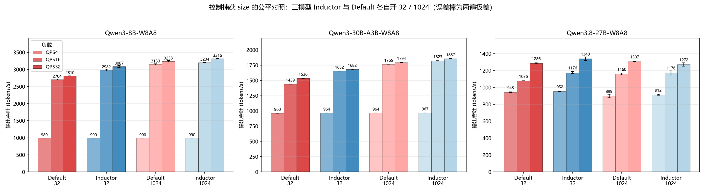

**QPS16 吞吐 (tokens/s)，每格为两遍均值**

| 模型 | Default32 | Inductor32 | Default1024 | **Inductor1024** | Inductor 净效果 @32 | **Inductor 净效果 @1024** |
|---|---:|---:|---:|---:|---:|---:|
| 8B | 2705 | 2982 | 3151 | **3204** | **+10.3%** | **+1.7%** |
| 30B | 1440 | 1652 | 1765 | **1823** | **+14.7%** | **+3.3%** |
| 27B | 1076 | 1176 | 1160 | 1176 | **+9.3%** | **+1.4%** |

QPS32 趋势相同：8B +9.8% → +2.4%，30B +9.5% → +3.5%，27B +4.2% → −2.6%。QPS4 下四者吞吐接近（受到达率限制），但 27B 的 Default1024 比 Default32 低 4.7%，扩大捕获在低负载下是回退。

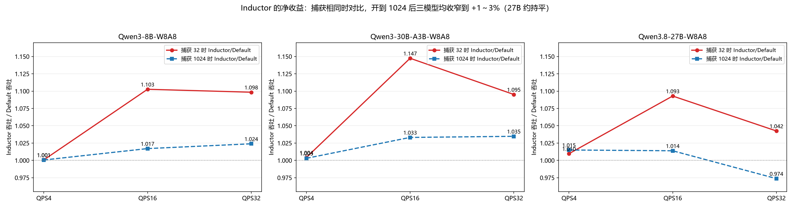

#### 四格对照的结论

1. **Inductor 的净收益随捕获窗口变化很大**：捕获 32 时 +10%（8B）/ +10～15%（30B）；捕获都开到 1024 后只剩 **+2%（8B）/ +3%（30B）**。两遍之间高度一致（8B I1024 QPS16：3205/3203），这 2～3% 是真实的小幅收益，不是噪声。
2. **扩大捕获与 Inductor 作用于同一处**：两者省的都是 Host 空闲和通信等待（3.7 节 Profile：扩大捕获让 Free 162→78，Inductor 让 Free 162→131），所以**大部分不可叠加**。
3. **Inductor 自身也从扩大捕获中获益**：8B +7.5%，30B +10.4%，与 Default 的增幅（+16% / +17～23%）同量级。
4. **最优配置是 Inductor + 1024**：比原始 Default32 高 18%（8B）/ 27%（30B），比 Default1024 仍高 2～3%。

#### 收益来源分解：decode 单步不变，差异全部来自 prefill 对 decode 的干扰

把平均 TPOT 拆成 **median ITL**（正常 decode 单步）和 **TPOT − median ITL**（其他请求 prefill、调度等待造成的干扰）：

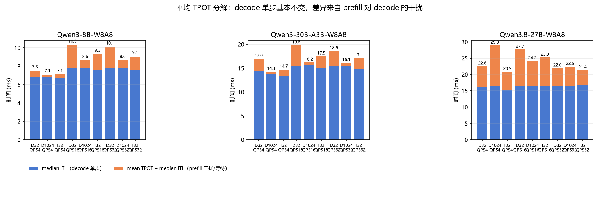

- **8B**：三条路径 median ITL 都在 7.6～7.8 ms。QPS16 下干扰项从 Default32 的 **2.76 ms** 降到 Default1024 的 **0.86 ms**（-69%）和 Inductor32 的 **1.64 ms**（-41%）。
- **30B**：median ITL 都在 15～15.6 ms。QPS16 下干扰项从 **4.92 ms** 降到 Default1024 的 **0.78 ms**（-84%）和 Inductor32 的 **2.94 ms**（-40%）。
- **27B**：median ITL 都在 16.6 ms。QPS16 下干扰项三者接近（**2.33 / 2.07 / 2.13 ms**），扩大捕获帮助有限。

因此 Inductor 的吞吐收益来源可以明确写成：**它缩短了非 replay 的 prefill/混合路径，减轻了新请求 prefill 对正在 decode 请求的阻塞；decode 单步本身没有加速。** 这与 3.4 节 27B 的事件级定位一致。

#### 27B 的特殊表现：扩大捕获收益最小，Inductor 从中完全没获益

27B（TP2）的四格对照：

| QPS | D32 | I32 | D1024 | I1024 | I32/D32 | I1024/D1024 | D1024/D32 | I1024/I32 |
|---:|---|---|---|---:|---:|---:|---:|---:|
| 16 | 1075/1078 | 1188/1164 | 1170/1149 | 1147/1204 | **1.093** | 1.014 | 1.077 | **1.000** |
| 32 | 1279/1293 | 1319/1362 | 1305/1308 | 1293/1252 | **1.042** | 0.974 | 1.016 | 0.949 |

（每格 rep1 / rep2。）

- 捕获相同时，27B 的 Inductor 净收益 +9.3%，与 8B/30B 同量级。
- **Default 从扩大捕获中获益最小**：D1024/D32 = 1.077，而 8B 是 1.165、30B 是 1.226。
- **Inductor 从扩大捕获中完全没获益**：I1024/I32 = 1.000，而 8B +7.5%、30B +10.4%。
- 27B 两遍波动明显大于 8B/30B（I1024 QPS16：1147 / 1204，相差 5%），所以 "+1.4%" 应理解为**约持平**，不是精确值。

纯 prefill Profile（3.7 节）与这个结果一致：27B 上 I1024 与 D1024 的 TTFT、Free、launch 都几乎相同，两种优化在同一处 Host 开销上完全重叠。

27B 为什么与 8B/30B 不同，**目前没有定位**。TP2 是最可疑的变量（每个 rank 独立捕获 12 个 PIECEWISE 尺寸，混合批次 replay 时两 rank 同步开销可能更高），但这需要 TP2 的 Profile 对比才能确认，当前只是一个假设。QPS4 下 Default1024 的 TTFT 从 261 ms 恶化到 1578 ms 也属于同一未决问题。

#### 适用边界

- 三模型四格对照每格 2 遍，但 27B 两遍波动约 5%，其 1024 列的 ±3% 以内差异不应过度解读。
- 27B 混合批次上扩大捕获收益有限的具体机制尚未定位；更细的捕获尺寸是否有效也未验证。
- QPS4 下吞吐受到达率限制，四种配置持平，此时比较吞吐没有意义，应看 TTFT。

## 6. 证据文件与复现

**新增本次补采（`profilling/20261123_top3_code_evidence/`）：**

- `27b_w8a8_generated_code/generated_code/`：27B-W8A8 的 38 个 Inductor 生成代码（含 `triton_unk_fused_add_npu_dynamic_quant_npu_rms_norm`、`triton_unk_fused_mul_npu_dynamic_quant_sigmoid_view`）。；
- `8b_w8a8_default_stack_profile/`、`27b_w8a8_default_stack_profile/`：Default 侧带 Python 栈 Profile。

**沿用既有证据：**

- 30B 生成代码与 MoE 调用栈：`profilling/20261123_032729_inductor_root_cause_evidence/`（`20261123_032729_30b_inductor_output_code.py` 第 325 行直接调用 `moe_forward`；`20261123_032729_30b_moe_auto_functionalization_stack.json`）；
- 8B 生成代码：`profilling/20261123_005556_inductor_advantage_evidence/20261123_005556_8b_w8a8_output_code_*.py`；
- 逐请求原始数据：`profilling/20261123_005556_inductor_advantage_evidence/*_raw.json`；
- 30B 六段分解：`profilling/20261123_032729_inductor_root_cause_evidence/20261123_032729_30b_prefill_stage_summary.csv`。

**8B ShareGPT 复测证据：**

- QPS16：`server-results/benchmark/20261123_8b_w8a8_qps16_retest_01/`，含三轮官方原始 JSON、逐轮对比，以及 `analysis/retest_analysis.json`、`analysis/retest_summary.csv` 的一致性重算结果；
- QPS4：`server-results/benchmark/20261123_8b_w8a8_qps4_retest_01/`，含一轮官方原始 JSON、对比、服务配置和运行日志；
- 当次临时编排与分析脚本已清理；吞吐、TTFT/TPOT 和一致性均可由保留的官方 JSON 重算。

**27B 超长间隔事件级定位证据：**

- `server-results/benchmark/20261123_27b_decode_gap_localization_01/`：无新请求插入的固定 decode 逐 token 时间戳、服务配置和日志；
- `analysis/prefill_stall_analysis.json`：共同停顿簇、首 token 对齐误差、纯 decode 对照和受控 prefill 的重算结果；
- 当次临时采集与分析脚本已清理；`replay_window_analysis.json` 和各目录原始数据保留了全部计算依据。

**27B 扩大图捕获对照证据：**

- `server-results/benchmark/20261123_27b_capture1024_comparison_01/`：三组有效 QPS4 原始结果、服务配置和日志，以及 `analysis/capture1024_analysis.json` 的共同停顿与 padding 重算；
- `server-results/benchmark/20261123_27b_replay_window_evidence/replay_window_analysis.json`：32/1024 的 2 秒窗口 replay 覆盖证据，含原始 trace 路径、首 token 数和模型执行/replay 事件数；
- 有效扩捕获结果名为 `default1024actual`；早期 `default1024` 文件因参数误被解析为 `model_tag`，明确排除；
- 当次临时采集与分析脚本已清理。

**公平对照矩阵证据（控制捕获 size，各 2 遍）：**

- `server-results/benchmark/20261123_fair_capture_matrix_01/`：8B/30B 的 `{Default, Inductor} × {32, 1024}` 四格原始 JSON 与日志，`analysis/fair_capture_matrix.json` 汇总三模型两遍吞吐和 Inductor/Default 比值；
- 27B 两轮原始结果位于 `server-results/benchmark/20261124_27b_fair_cap32/` 和 `server-results/benchmark/20261124_27b_fair_cap1024/`，由更新后的 `tests/benchmark/run_performance.sh` 运行；1024 使用 `--capture-size 1024`；
- 27B 纯 prefill 四路径 Profile 的中间数据见 `20261123_27B_prefill_profile_中间结果.md`。

**旧版不公平对照矩阵（Inductor 仅开 32，已被上面的公平对照取代）：**

- `server-results/benchmark/20261123_capture_qps_matrix_01/`：27 格的官方 `vllm bench serve` 原始 JSON、各服务配置与日志、`ready.json`；
- `analysis/capture_qps_matrix.json`：逐格吞吐/TPOT/TTFT/并发、相对两种基线的加速比、共同停顿统计、TPOT−ITL 分解；
- 当次临时编排与分析脚本已清理；逐格官方 JSON 和分析 JSON 均保留。

**图与重算依据：** 图均由保留的官方 JSON、Profile 汇总和 trace 生成；当次临时可视化脚本已清理，图文件保留在 `20261123_top3_assets/`。

**图索引：** fig1 30B 六段瀑布图、fig2 三场景时间构成、fig3a 27B ITL 与逐请求 TPOT 分布、fig3b 27B 平均 TPOT 收益来源分解、fig4a/b/c 分别为 8B/27B/30B 的负载-收益曲线、fig5 8B QPS16 三轮复测、fig6 27B prefill 停顿的实际 token 时间轴、fig7 27B FULL replay → NONE → FULL replay 执行路径切换、fig8 27B 扩大 Default 图捕获范围对照、fig10/fig11 旧版不公平对照（保留作对比说明）、fig13 三模型 TPOT−ITL 分解、**fig14 公平对照四格吞吐、fig15 Inductor 净收益随捕获窗口的变化**，代码对比① RMSNorm、② MoE、③ 27B 融合，均位于 `20261123_top3_assets/`。

## 7. 末尾备注：未复现的原始 8B 结果

以下仅保留历史记录，不参与正文结论和图表：

- 原始 QPS16：吞吐 1433.2 → 3027.7 tokens/s（2.11×）、TPOT 加速比 2.17×、TTFT 加速比 7.00×；三轮复测均未复现该倍率。
- 原始 QPS4：吞吐加速比 1.030×、TPOT 加速比 1.640×、TTFT 加速比 2.324×；一轮复测分别为 1.001×、1.025×、1.110×。
- 原始运行记录中 Default 为 cold cache、Inductor 为 warm cache；复测双方均为 warm cache。原始 Default 偏低的具体原因尚未定位，不能据此归因于 Inductor 或缓存状态。
