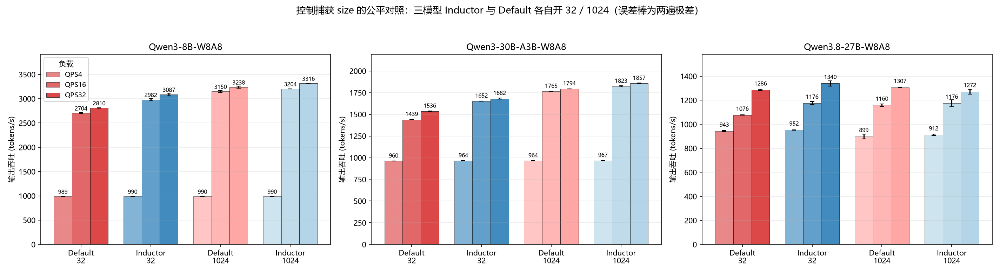
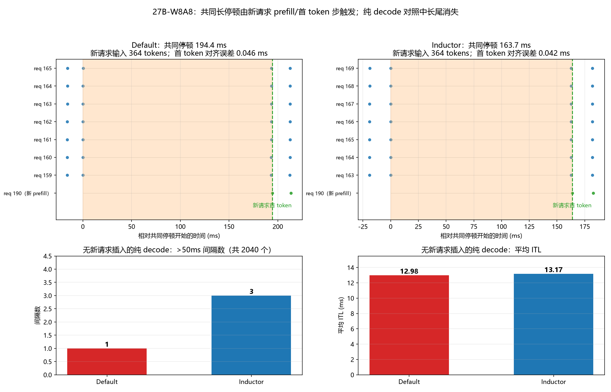
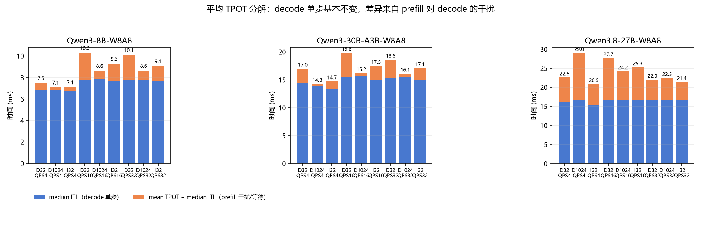
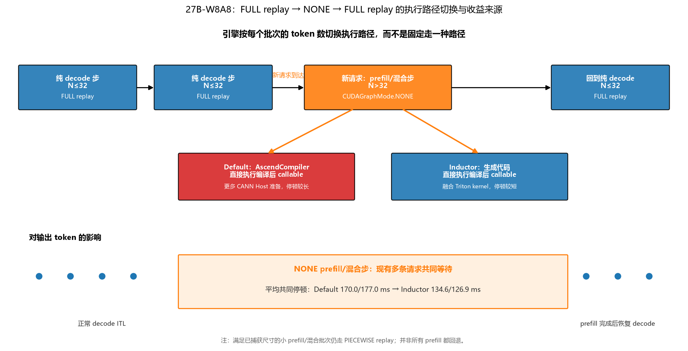
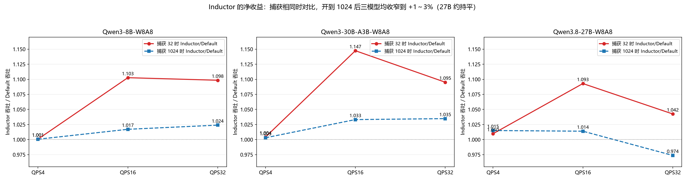

# Inductor 性能收益来源与图捕获窗口对照：最终结果

日期：2026-11-24。环境：A5-25，Ascend950DT，torch 2.13 / vLLM 0.33。

本文只保留已核对或复测支持的结论。本目录下的早期长文档记录了中间假设和修正过程，不作为最终结论入口。

## 1. 最终结论

1. **Inductor 的收益主要来自 prefill/混合执行路径的 Host 与空闲开销下降，不是主要计算 kernel 提速。** GEMM、Attention、MoE、HCCL 的累计时间在有效对照中基本持平。
2. **decode 的 TPOT 收益不是 decode 单步计算变快。** 三条路径的 median ITL 基本相同；差异来自新请求 prefill/首 token 步对正在 decode 请求的阻塞程度。
3. **扩大图捕获窗口与 Inductor 的收益大部分不可叠加。** 两者优化的是同一类 Host/空闲开销。
4. **公平对照下 Inductor 仍有小幅净收益，但远小于原始 32 上限下的收益。** 三模型在 QPS16 下：8B +10.3% → +1.7%，30B +14.7% → +3.3%，27B +9.3% → 约持平。
5. **当前最优配置是 Inductor + 1024**（就本报告覆盖的 ShareGPT 负载而言），但 27B 的混合批次表现和更大捕获开销仍需单独评估。
6. **27B 混合批次差异已定位到大形状逐层 PIECEWISE replay 回退**：当 prefill+decode 进入 256/512/1024 捕获图时，逐层 replay 的 API 墙钟阻塞（含设备执行和同步等待）与额外计算超过直接执行收益；TP2 不是必要条件，Inductor 也不能消除该成本。

## 2. 三个主要收益场景

以下 Inductor/Default 比值均在两条路径使用相同捕获窗口时测得。每格为两遍独立服务的均值。

| 场景 | 负载 | Default32 → Inductor32（吞吐 tokens/s） | Inductor 净收益 |
|---|---|---:|---:|
| **Qwen3-8B-W8A8** | ShareGPT QPS16 | 2705 → 2982 | **+10.3%** |
| **Qwen3-30B-A3B-W8A8** | ShareGPT QPS16 | 1440 → 1652 | **+14.7%** |
| **Qwen3.8-27B-W8A8（TP2）** | ShareGPT QPS16 | 1076 → 1176 | **+9.3%** |

QPS32 下仍有收益，但略收窄：8B +9.8%、30B +9.5%、27B +4.2%。QPS4 下吞吐接近，主要应看 TTFT 而非吞吐。



## 3. 收益为什么出现：事件链

### 3.1 长间隔发生在 decode，但由其他请求的 prefill 触发

- ITL 是首 token 之后相邻输出 token 的间隔，所以长间隔发生在 decode 输出过程中。
- 27B QPS4 原始数据中，Default 的 4494 个 >50 ms 间隔可合并为 155 个跨请求共同停顿簇，99.87% 的长间隔至少有 4 条请求共同经历。
- 停顿簇结束时间与另一条请求的首 token 时间对齐，最大误差不超过 0.25 ms。
- 无新请求插入的固定 decode 对照中，Default/Inductor 分别只有 1/2040、3/2040 个 >50 ms 间隔，平均 ITL 为 12.98/13.17 ms。

因此：**长停顿是引擎级的 prefill/首 token 步对 decode 的阻塞，不是某个 decode kernel 单独变慢。**



### 3.2 TPOT 分解

把平均 TPOT 拆为 `median ITL`（正常 decode 单步）和 `TPOT − median ITL`（prefill 干扰/等待）：

- 8B QPS16：median ITL 三条路径均为 7.6～7.8 ms；干扰项从 Default32 的 2.76 ms 降到 Default1024 的 0.86 ms、Inductor32 的 1.64 ms。
- 30B QPS16：median ITL 均为 15～15.6 ms；干扰项从 4.92 ms 降到 0.78 ms、2.94 ms。
- 27B QPS16：median ITL 均约 16.6 ms；干扰项三者接近，为 2.33 / 2.07 / 2.13 ms。



### 3.3 Inductor 在设备端做了什么

27B 纯 prefill Profile（固定 8×256、TP2）显示：

- 三路径 Computing 相同（279.1 / 279.7 / 282.7 ms）；
- Inductor 消除 Add、Sigmoid、Mul、RmsNorm 等原生小算子，并生成 11 类 Triton kernel；
- Slice 从 7.8 ms 降到 3.8 ms；
- 主要 GEMM 和 HCCL 时间持平。

所以 Inductor 的价值主要是**用融合后的 kernel 减少 Host 提交、数据准备和设备间隙**，不是让大计算 kernel 更快。

## 4. 图捕获窗口：为什么它会改变 Inductor 的收益

执行路径会按引擎步切换：

- 纯 decode 小批次（`num_tokens≤32`）：Default 与 Inductor 都可走 FULL replay；
- 大 prefill/混合批次超过捕获上限：回退为 `CUDAGraphMode.NONE`，双方直接执行编译后的 callable；
- prefill 完成后再回到 FULL replay。



因此 Inductor 的收益集中出现在**未进入 replay 的 prefill/混合路径**。如果 Default 也扩大捕获，它会获得一部分同样的 Host 收益，Inductor 的净优势自然缩小。

### 公平四格对照

`{Default, Inductor} × {32, 1024}`，QPS 4/16/32，每格两遍，服务日志校验 backend 与捕获配置。

**QPS16 吞吐（tokens/s，两遍均值）**

| 模型 | Default32 | Inductor32 | Default1024 | Inductor1024 | Inductor @32 | Inductor @1024 |
|---|---:|---:|---:|---:|---:|---:|
| 8B | 2705 | 2982 | 3151 | **3204** | +10.3% | +1.7% |
| 30B | 1440 | 1652 | 1765 | **1823** | +14.7% | +3.3% |
| 27B | 1076 | 1176 | 1160 | 1176 | +9.3% | 约持平 |



**读图要点**：捕获 32 时 Inductor 领先明显；捕获都开到 1024 后，优势收窄到 1～3%。但 Inductor + 1024 仍是整体最优，并未被 Default1024 完全替代。

## 5. 27B 纯 prefill 四路径 Profile

固定 8 请求 × 256 输入 tokens、TP2，收到首 token 即停止采集。Inductor 组启动后校验实际 backend。

| 两 rank 合计 | Default32 | Default1024 | Inductor32 | Inductor1024（r1 / r2） |
|---|---:|---:|---:|---:|
| TTFT 均值 | 296.6 ms | **212.2 ms** | 265.1 ms | 247.0 / **212.3 ms** |
| Stage | 688.7 | 500.3 | 608.2 | 588.8 / **501.1** |
| Computing | 279.1 | 279.7 | 282.7 | 283.5 / 283.2 |
| Communication | 247.3 | 142.7 | 195.0 | 170.0 / **144.3** |
| Free | 162.3 | 77.9 | 130.5 | 135.3 / **73.6** |
| replay 次数 | 3 | **68** | 3 | **68** |
| Host launch 累计 | 303.7 | 214.5 | 277.3 | 277.7 / **215.4** |

结论：27B 纯 prefill 上，Default1024 与 Inductor1024 基本持平；两者作用于同一处 Host 开销，收益不可叠加。这里的 8×256=2048 tokens 已超过捕获上限，不能用来排除较小 prefill+decode 混合步进入 replay 后的 padding 与执行开销；混合路径结论见下节。

## 6. “27B 在持续到达的混合批次上为什么不同”是什么意思

这一现象已通过正式 ShareGPT 混合窗口、逐请求数据和 TP1/TP2 对照定位。

### 6.1 什么是持续到达的混合批次

测试不是一次只跑一个请求，而是 ShareGPT 按 QPS 持续到达。某些引擎步会同时处理：

- 已有请求的 decode；
- 新到请求的 prefill。

这种步就是 prefill+decode 混合批次。它会影响正在输出 token 的其他请求。

### 6.2 27B 与 8B/30B 不同在哪里

| 现象（QPS16） | 8B | 30B | 27B |
|---|---:|---:|---:|
| Default 扩大捕获后的吞吐增幅 | +16.5% | +22.6% | **+7.7%** |
| Inductor 从 32 扩到 1024 的增幅 | +7.5% | +10.4% | **约 0%** |
| 扩大捕获后长停顿 | 消失或极少 | 消失 | **仍大量存在** |
| 两遍结果波动 | 小 | 小 | **约 5%** |

此外 27B 在 QPS4 下，Default1024 的 TTFT 比 Default32 更差（1578 ms vs 261 ms），而 8B/30B 是改善。

### 6.3 大混合步为什么反而更慢

先看正式 ShareGPT 混合窗口。Default1024 的 4 个最长混合步为 271.6～285.2 ms，关联输入长度为 267、514、679、849 tokens；普通 decode 步约为 17～23 ms。下表比较四种配置的代表长步，数值为中位数。

| 指标 | Default32 | Inductor32 | Default1024 | Inductor1024 |
|---|---:|---:|---:|---:|
| 整步 Stage（ms） | 150.4 | 128.3 | 278.1 | 282.1 |
| 直接 launch API 累计（ms） | 61.1 | 44.2 | 6.2 | 6.2 |
| `aclmdlRIExecuteAsync` 次数 | 0～1 | 0～1 | 64 | 63～64 |
| replay API 墙钟累计（ms） | 约 0 | 约 0 | 186.6 | 187.2 |
| Computing（ms） | 21.6 | 35.5 | 55.6 | 58.3 |
| QuantBatchMatmulV3（ms） | 7.9 | 16.1 | 32.2 | 32.2 |

其中，replay API 墙钟包含设备执行和同步等待，不是纯 Host CPU 成本；各指标存在交叉，不能相加。

可以看到，扩大捕获虽然降低了直接 launch，却引入了更高的逐层 replay 墙钟，最终整步反而变慢。Inductor1024 与 Default1024 的表现基本一致。

这说明问题不在“是否使用 replay”，而在**大混合步的 replay 执行与等待超过了它节省的直接执行成本**。长步包含 48 个 GDN attention core 和 16 个 full attention core，对应 64 层各一段 PIECEWISE replay。较小混合步虽然也有约 64 次 replay，但 replay API 累计只有 1～5 ms，因此不能把问题理解为固定次数开销。

两 rank 的 Communication/Free 呈互补：一个 rank 等通信时，另一个 rank 显示 Free。长步 HCCL device 累计约 10.7～11.1 ms，Default32 约为 6.5 ms，不能解释约 280 ms 的整步时间。TP1 固定混合对照也复现了 65 次 replay、API 墙钟累计 77.2 ms，说明 **TP2 会放大等待，但不是回退的必要条件**。

端到端结果与上述路径一致：Default32/Inductor32 的 >200 ms ITL 分别只有 64/63 个，Default1024/Inductor1024 增至 2403/2407 个；1024 两组吞吐都约 878 tokens/s，低于 32 两组的 942～950 tokens/s。按“新请求输入长度 + 共同停顿请求数”估算，混合 tokens 不超过 128 时停顿中位数约 58 ms，超过 128 后约 230～252 ms。这个 128 只是客户端数据估算的近似分界，不是引擎直接记录的严格调度阈值。

因此，**27B 的问题是大 prefill+decode 混合步进入逐层 PIECEWISE replay 后发生回退，Inductor 也无法消除这条原生 replay 路径的成本。**

### 6.4 replay API 时间为什么会随形状变化

下表使用 Default1024 的真实 trace，对比一个小混合步和一个大混合步。两者的 replay 次数相同，但单次调用时长相差约 37 倍。

| 指标 | 小混合步 | 大混合步 |
|---|---:|---:|
| 整步 Stage（ms） | 93.1 | 285.2 |
| replay 调用次数 | 65 | 65 |
| replay API 累计（ms） | 5.093 | 186.840 |
| 单次 replay 平均时长（ms） | 0.078 | 2.874 |
| 单次 replay 中位时长（ms） | 0.065 | 2.869 |
| 单次 replay 最大时长（ms） | 0.552 | 3.572 |

因此，差异不在于“64 次 replay”这一数量，而在于大混合步每次调用的执行与等待都被放大。

`aclmdlRIExecuteAsync` 名称中的 Async 不保证调用立即返回。长步中的 65 次较长 replay 调用全部超过 1 ms，并与设备事件重叠。例如，一次 2.85 ms 调用与 62 个设备事件重叠，另一次 2.84 ms 调用与 76 个设备事件重叠；事件包括 QuantBatchMatmul、ChunkGatedDeltaRule、HCCL 和 `NOTIFY_WAIT`。因此，**replay API 墙钟不是纯 Host CPU 成本，也不能与 Computing 直接相加。**

形状的影响可以概括为：

> kernel 形状改变设备执行和依赖时间，后续 replay 的提交或返回又受到队列与同步约束，最终表现为 replay API 墙钟增加。

GDN 影响的正是图片段边界上的工作，包括 chunk prefill、CausalConv1d、recurrent state 更新和 TP2 rank 等待。层数和 padding 比例本身都不足以解释这一差异，下一节进一步比较三个模型。

目前可以确认的是**大混合步的 replay 执行与同步阻塞**。至于具体是哪一个 GDN kernel，或 CANN 内部通过何种队列、依赖和同步机制形成阻塞，还需要同形状跨模型对照和 GDN 路径消融。原始重叠证据见 `server-results/benchmark/20261124_27b_mixed_profile_qps4_aligned_01/analysis/replay_host_overlap.json`，逐次调用时长见 `server-results/benchmark/20261124_27b_mixed_profile_qps4_aligned_01/analysis/replay_call_durations.json`。

### 6.5 为什么长等待出现在 27B，而 8B/30B 没有

直接原因不是“27B 的 replay 次数更多”，而是 **27B 每次 replay 所涉及的图内容和边界依赖不同**。三个模型的结构对比如下：

| 维度 | Qwen3-8B | Qwen3-30B-A3B | Qwen3.8-27B |
|---|---|---|---|
| 层数与 attention 结构 | 36 层标准 full attention | 48 层标准 full attention | **48 层 GDN + 16 层 full attention** |
| prefill 边界工作 | 标准 attention | 标准 attention | GDN chunk prefill、CausalConv1d、recurrent state 更新和标准 attention |
| 大混合步的 replay 表现 | 未观察到同等长等待 | 未观察到同等长等待 | **每次 replay 的执行与等待显著放大** |
| 扩大捕获后的长停顿 | 消失或极少 | 消失 | 仍大量存在 |

27B 的 GDN prefill 不只是矩阵计算，还包含 recurrent state 和卷积、chunk 等工作。大混合批次会改变这些 kernel 的执行时间以及图片段之间的依赖时间，replay 提交和返回随之受到队列与同步约束。于是，单次 replay 从不到 0.1 ms 增至约 2.9 ms，约 64 次累计后形成约 190 ms 的长等待。

8B/30B 没有这套 GDN recurrent-state 与 chunk-prefill 组合，其 replay 边界主要是标准 full attention。在当前 ShareGPT 覆盖范围内，它们的 replay 没有形成同等程度的阻塞，因此扩大捕获主要体现为 Host 收益，长停顿反而减少。

还需要排除两个表面解释：

- **不是单纯层数更多。** 36/48/64 层只能解释约 1.3～1.8 倍的调用次数差异，无法解释单次 replay 从不到 0.1 ms 增至约 2.9 ms。
- **不是单纯 padding 或 TP2。** 三模型 padding 比例接近；27B 在 TP1 下也复现了逐层 replay 回退，TP2 只是进一步放大等待。

因此，当前最准确的解释是：**27B 特有的 GDN 混合 attention 结构，使大混合步的 replay 执行与依赖路径比 8B/30B 更复杂，最终形成长等待。** 但这仍是结构层归因，尚不能据此认定某个 GDN kernel 或 CANN 实现存在缺陷；需要同形状跨模型对照和 GDN 路径消融进一步验证。

### 6.6 带栈 Profile：时间主要花在 graph 任务等待

为确认 replay 内部到底在做什么，又补采了 Default1024 的 `torch_profiler_with_stack=True` 混合 Profile。实现上，该选项在 vllm-ascend 中映射为 `with_modules=True`，真正的 `with_stack` 仍为 `False`，因此这里得到的是模块和函数调用关系，不是完整的 Python/C++ 栈。带栈采集自身开销较大，下面的数值只用于定位，不能与不带栈的 65 次、186.6 ms 直接比较。

最长 `run_pw_graph` 为 328.2 ms。Python 调用关系显示，逐层 replay 最终都进入 `NPUGraph.replay` 的 pybind/C++ 调用，Python 层没有更深的业务函数热点。

| 调用位置 | 次数 | 累计时间 | 说明 |
|---|---:|---:|---|
| `run_pw_graph`（全部） | 7 | 1585.4 ms | 最长一次 328.2 ms |
| `ACLGraphWrapper.__call__`（最长步） | 65 | 214.2 ms | 逐层进入 replay |
| `NPUGraph.replay`（最长步） | 65 | 211.6 ms | 与上一层调用时间基本一致 |
| pybind replay（最长步） | 65 | 211.1 ms | Python 调用链在这里结束 |
| `async_utils.get_output` 中的 synchronize | 35 | 418.4 ms | 等 worker 输出，不能归因于 GDN 或 replay 内部实现 |

对最长步的设备事件进一步分类，可以看到等待类事件远比单个 GDN kernel 突出。以下时长跨 stream 重叠，**不能相加，也不能直接当成关键路径求和**。

| 设备事件 | 次数 | 累计时间 | 最大单次 |
|---|---:|---:|---:|
| `NOTIFY WAIT` | 389 | 309.7 ms | 25.3 ms |
| `NOTIFY_WAIT_SQE` | 985 | 269.4 ms | 8.1 ms |
| `EVENT WAIT` | 393 | 196.8 ms | 19.9 ms |
| `MODEL_WAIT_COMPLETE` | 66 | 176.4 ms | 17.7 ms |
| QuantBatchMatmulV3 | 460 | 34.6 ms | 0.226 ms |
| HcclLaunchAicpuKernel | 130 | 11.7 ms | 0.184 ms |
| RecurrentGatedDeltaRule | 72 | 2.9 ms | 0.048 ms |
| ChunkGatedDeltaRuleFwdPrepare / ChunkFwdH / ChunkFwdO | 48 / 48 / 48 | 6.2 ms（合计） | — |
| CausalConv1d | 120 | 2.2 ms | 0.034 ms |

例如，一次 3.81 ms 的 replay 调用与 1186 个设备事件重叠，其中 `EVENT WAIT` 累计 40.8 ms、`NOTIFY WAIT` 34.9 ms、`MODEL_WAIT_COMPLETE` 17.8 ms，而 QBM 只有 0.75 ms。这说明 replay API 时间包含其他 graph 的执行与同步，不是 replay API 自身或某个 kernel 的纯计算时间。

因此，带栈结果把问题进一步限定为：**大混合步中，graph 任务之间的依赖和等待是主要现象，不能简单归因为 GDN kernel 计算慢。** 若要继续确定 CANN 内部具体是哪条流队列、依赖或同步规则导致 replay 未快速返回，需要 CANN 级 trace 或在 graph runtime 中增加定点 instrumentation。原始分析见 `server-results/benchmark/20261124_27b_mixed_profile_stack_01/analysis/stack_replay_analysis.json`。

### 6.7 长 Communication 的真实原因：worker 执行批次错位

进一步联合检查 AllReduce、RPC 和 replay 后，可以排除“rank 没提交 AllReduce”或“10 MiB 数据传输本身很慢”。实际情况是：**先到达集合点的 rank 在等另一个 rank 到达，另一个 rank 的整个 `execute_model` 批次到得晚。**

| 调用阶段 | 时间差（后到达 rank − 先到达 rank） | 说明 |
|---|---:|---|
| `_execute_worker_rpc` 开始 | +8.830 ms | 整个 worker 执行批次到得晚 |
| `run_pw_graph` 开始 | +8.344 ms | 延迟延续到图执行 |
| AllReduce Host 提交 | +8.408 ms | 并不是没有提交 |
| AllReduce 设备开始 | +7.968 ms | 先到达的 rank 在这里等待 |
| AllReduce 设备结束 | 约 0 ms（相差 0.003 ms） | 两个 rank 几乎同时完成 |

两个 rank 的 AllReduce 参数一致：`rank_size=2`、BF16、`count=5,242,880=1024×5120`，对应约 10 MiB 的 GDN 相关输出激活。先到达的 rank 出现约 8 ms 的 Communication，后到达的 rank 自己的 HCCL 执行只有约 0.236 ms。因此长 Communication 主要是**集合点等待**，不是通信带宽成本。

`dequeue` 本身只有约 0.28～0.30 ms，不是队列读取阻塞。补充 `MessageQueue.enqueue/dequeue` 时间戳也确认：writer 对两个 rank 同时 enqueue，差异发生在 worker 的 `execute_model` 处理阶段。另一个 rank 显示 `Free`，只表示它当时没有设备任务在执行，**不表示它已经完成 AllReduce**。

因此，TP2 的作用是放大 replay 中的集合点等待，不能把长 Communication 归因于某个 GDN kernel 或网络传输。当前证据还不能进一步确定 worker 执行偏移最初由哪种 Host 调度或 graph 依赖产生。原始时间线见 `server-results/benchmark/20261124_27b_mixed_profile_stack_01/analysis/rpc_offset_analysis.json`，RPC hook 结果见 `server-results/benchmark/20261124_27b_rpc_trace_stack_01/`。

## 7. 原始数据与复现

### 7.1 主要结果目录

- 8B/30B 公平四格：`server-results/benchmark/20261123_fair_capture_matrix_01/`
- 27B 捕获 32 两轮：`server-results/benchmark/20261124_27b_fair_cap32/`
- 27B 捕获 1024 两轮：`server-results/benchmark/20261124_27b_fair_cap1024/`
- 汇总：`server-results/benchmark/20261123_fair_capture_matrix_01/analysis/fair_capture_matrix.json`
- 27B 纯 prefill 中间结果：`./20261123_27B_prefill_profile_中间结果.md`
- 事件级定位：`server-results/benchmark/20261123_27b_decode_gap_localization_01/`
- replay 窗口证据：`server-results/benchmark/20261123_27b_replay_window_evidence/replay_window_analysis.json`
- 27B 正式混合负载四路径：`server-results/benchmark/20261124_27b_mixed_profile_qps4_aligned_01/`；逐步与算子分析见其 `analysis/sharegpt_steps.json`，replay 与设备事件重叠证据见 `analysis/replay_host_overlap.json`
- 27B 8 路固定混合 TP1/TP2：`server-results/benchmark/20261124_27b_mixed_controlled_02/`
- 27B 31 路固定混合：`server-results/benchmark/20261124_27b_mixed_controlled31_01/`
- 27B 带栈混合 Profile：`server-results/benchmark/20261124_27b_mixed_profile_stack_01/`；函数与等待事件分析见 `analysis/stack_replay_analysis.json`，rank 执行偏移分析见 `analysis/rpc_offset_analysis.json`
- 27B RPC hook 联合采集：`server-results/benchmark/20261124_27b_rpc_trace_stack_01/`

### 7.2 工具改动

`tests/benchmark/` 新增 `--capture-size`、`--qps`、`--skip-long`，已提交：

```text
分支：feat/benchmark-capture-size-controls
提交：fc8dff8 feat(benchmark): add capture-size controls to performance runs
```

27B 两轮 ShareGPT 复现命令：

```bash
bash ../tests/benchmark/run_performance.sh \
  --model /mnt/weight/Qwen3.8-27B-w8a8 \
  --workspace "$WORKSPACE" --results "$OUT" --sharegpt "$SHAREGPT" \
  --devices 0,1 --tp 2 --cache-root "$CACHE_ROOT" \
  --qps 4,16,32 --skip-long --repeats 2 --timeout 3600
```

1024 组额外加 `--capture-size 1024`，并使用与 32 产物隔离的 cache-root。

### 7.3 限制

- 公平矩阵每格两遍，但 27B 波动约 5%，±3% 内差异不宜过度解读。
- 27B 混合批次已定位为逐层 PIECEWISE replay 回退；具体 GDN kernel、CANN 阻塞实现、同形状跨模型对照和 GDN 消融尚未验证。
- 128/256 等更细捕获尺寸的收益与修复方案尚未验证。
- 本文只讨论性能，不构成精度结论。

### 末尾备注：早期未复现的 8B 结果

原始批次中 8B QPS16 曾出现 2.11× 吞吐加速，后续三轮独立服务复测均未复现。该结果不参与本文任何结论或图表。
